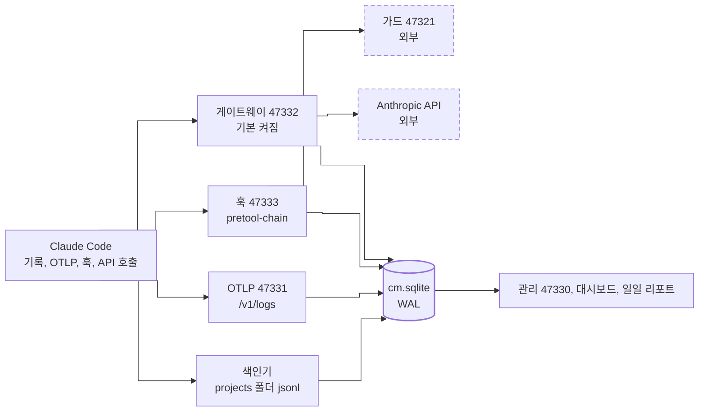
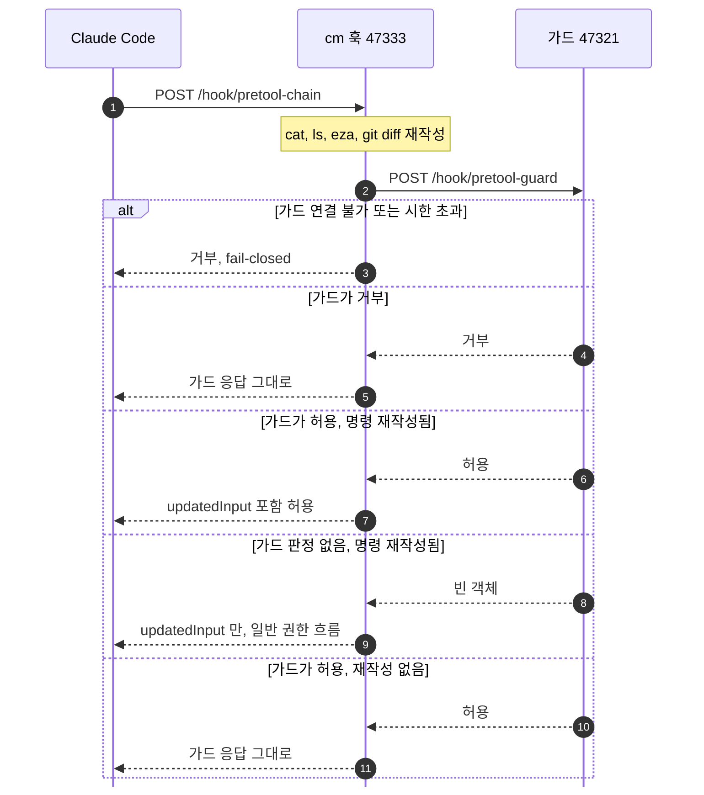

# Architecture

## 소스 트리

```markdown
claude-monitor/
├── src/
│   ├── main.rs : 실행 진입점, clap 명령(serve, start, tui, index, report, hook, status, doctor), 명령 없이 실행 시 동작(분리 serve 기동 후 대시보드), 종료 코드
│   ├── lib.rs : 라이브러리 루트, 공개 모듈
│   ├── core/
│   │   ├── mod.rs : core 모듈 묶음
│   │   ├── config.rs : config.toml 로더(~/.config/claude-monitor/config.toml), 포트·게이트웨이·훅·색인기·리포트 설정, 데이터 폴더(기본 ~/.config/claude-monitor로 config.toml과 같은 폴더이며 CM_DATA_DIR로 변경)와 Claude 홈 결정
│   │   ├── context.rs : 모든 포트와 작업이 공유하는 AppContext, 실시간 카운터, 실시간 이벤트 broadcast 채널
│   │   └── model.rs : 기록 행 형태, DataSource, HookOutcome, LiveEvent, 상태 스냅샷, 거부 재왕복 상수
│   ├── serve/
│   │   └── mod.rs : serve 진입, 포트 바인드 보유, 배경 분리 기동(serve.log), 저장소와 관리 토큰 준비, 주·게이트웨이 런타임, 작업 감독, 종료
│   ├── store/
│   │   ├── mod.rs : SQLite 스키마, WAL, 중복 제거 적재 묶음 기록, 색인 커서, 일일 리포트 보관
│   │   └── query.rs : 관리 API·대시보드·리포트 공용 집계, 백분위, 비용 추정
│   ├── net/
│   │   ├── mod.rs : localhost HTTP 포트 묶음
│   │   ├── common.rs : 127.0.0.1 서버 루프, Host·Origin·Sec-Fetch-Site 거부, 응답 공용 형태
│   │   ├── admin/
│   │   │   ├── mod.rs : 관리 경로, 토큰 검사, 집계, 재색인, 리포트
│   │   │   ├── events.rs : 실시간 이벤트 Server-Sent Events 스트림
│   │   │   ├── client.rs : 대시보드·status용 블로킹 HTTP/1.1 관리 클라이언트
│   │   │   ├── tests.rs : 관리 클라이언트, 토큰, 집계, SSE 테스트
│   │   │   └── test_support.rs : 네트워크 테스트용 임시 저장소, 빈 포트, 원시 요청
│   │   ├── otlp/
│   │   │   ├── mod.rs : OTLP http/json 수신, gzip, 크기 상한
│   │   │   ├── mapping.rs : 로그 레코드를 행으로 변환, 속성 일부만 사용
│   │   │   └── tests.rs : fixture 변환, 키 대체, 서버 검사
│   │   └── gateway/
│   │       ├── mod.rs : Anthropic API 중계, 헤더 복사, 상류 호출
│   │       ├── tap.rs : 응답 계측, 첫 바이트·첫 토큰 시각, SSE 사용량 파서
│   │       └── tests.rs : 청크 경계 파싱, 계측 기록, 상류 오류, hop-by-hop 헤더
│   ├── hooks/
│   │   ├── mod.rs : 훅 서버 경로, 요청 상한
│   │   ├── chain.rs : pretool-chain 판정, 가드 응답 합성, fail-closed
│   │   ├── rewrite.rs : 보수적 Bash 재작성(cat, ls, eza, git diff)
│   │   ├── relay.rs : 다른 훅 경로의 계측 중계
│   │   ├── standby.rs : 대기 안내 경로, 도구 실패·프롬프트에 additionalContext 응답
│   │   ├── upstream.rs : 가드로 가는 keep-alive HTTP 클라이언트와 마감 시한
│   │   ├── record.rs : 카운터, 실시간 이벤트, 응답 경로 밖 저장소 기록
│   │   ├── client.rs : 블로킹 HTTP 클라이언트와 hook 명령
│   │   └── chain_tests.rs : 가짜 가드 서버를 쓴 체인 테스트
│   ├── transcript/
│   │   ├── mod.rs : 증분 색인기, 1회 실행, 주기 루프
│   │   ├── files.rs : projects 폴더의 최근 jsonl 탐색
│   │   ├── scan.rs : 오프셋 이후 완결 줄 읽기, 행 생성
│   │   ├── lines.rs : 줄 최소 역직렬화, 가드 거부 문구 판독
│   │   ├── tests.rs : 합성 기록 색인 테스트
│   │   └── test_support.rs : 임시 폴더와 테스트 설정
│   ├── report/
│   │   ├── mod.rs : 일일 리포트 생성, 보관, 파일 기록, 예약
│   │   ├── render.rs : 집계를 박스 표가 있는 한국어 Markdown으로 변환, 규칙 기반 제안
│   │   ├── table.rs : 가벼운 선 박스 표 렌더러(한글 폭 2)와 파이프 표를 박스 표로 바꾸는 변환
│   │   └── tests.rs : 색인, 집계, 리포트 흐름과 예약 시각
│   ├── inventory/
│   │   ├── mod.rs : 훅·MCP·에이전트·스킬·env 키 목록 형태, doctor 진입
│   │   ├── load.rs : settings.json, .claude.json, 에이전트·스킬 머리글 읽기, 값 제외
│   │   ├── doctor.rs : 데이터 폴더, 포트, 중계 대상, 훅 등록, 허용 URL, 텔레메트리, 게이트웨이, projects 폴더 점검
│   │   └── tests.rs : fixture Claude 홈을 쓴 목록·진단 테스트
│   ├── power/
│   │   ├── mod.rs : 대기 감시 스레드, 절전 유예 요청(Win32 직접 선언), 대기 구간 기록, 안내 문구
│   │   └── tests.rs : 대기 감지, 유예 유지·해제, 안내 대상 선택, 훅 응답 테스트
│   └── tui/
│       ├── mod.rs : 터미널 진입·복원, 변화 시에만 다시 그리는 이벤트 루프(AppState::tick 호출, 대기 시간을 누름 마감까지로 줄임), 시작 시 상태 불러오기, SaveState는 터미널 가드가 소유한 상태 저장 스레드에 쓰기를 맡김, 명령 전달, 크기 변경 시 카드 이동 취소
│       ├── state.rs : 탭, 카드 포커스·배치·스크롤, 구간, 표시 언어, 누름·이동 상태, 패널 데이터, 키 처리(Shift+방향키, l, L), 스냅샷 교체 시 선택 유지
│       ├── cards.rs : 카드 식별자·종류, 카드별 스크롤·선택, 클릭 동작, 마우스 적중 영역, 스크롤바 썸 계산
│       ├── layout.rs : 카드 경계 드래그 크기 조절, 그룹별 비율·카드 순서, 카드 영역 분할, 드래그 영역
│       ├── card_move.rs : 카드 이동 상태 기계(impl AppState): 제목 400 ms 길게 누름, 미리보기, 확정, 취소, Shift+방향키 한 칸 이동, 시각은 Instant 인자(AppState::tick)로 받아 테스트가 시계를 주입
│       ├── layout_store.rs : 홈 설정 폴더의 상태 파일 tui.toml: 시작 시 불러오기, 상태 문자열과 저장 요청 만들기, 원자적 쓰기(임시 파일 후 이름 바꾸기, 심볼릭 링크 사슬은 최대 16단계까지 먼저 풀어 모든 링크 유지), 시작 시 오래된 임시 파일만 삭제(10분 넘게 수정되지 않은 것, 실행 중 프로세스 것은 제외), 맞지 않는 항목은 알림 한 번과 함께 건너뜀, 읽을 수 없는 파일은 `.bak`으로 복사
│       ├── state_writer.rs : 상태 저장 스레드: 경로별 최신 요청하나로 합치는 저장 요청 채널, Drop 시 남은 요청 쓰기와 스레드 합류(최대 5초만 기다리고 터미널 가드가 stderr에 경고), 실패는 UiMessage::StateSaveFailed로 돌려보냄
│       ├── i18n.rs : 항목마다 영어·한국어 문구를 둔 문구 카탈로그(기본 영어), 값이 들어가는 문구의 형식 함수, 도움말 줄
│       ├── mouse.rs : 호버, 클릭, 제목 누름, 경계 드래그, 카드 이동 미리보기·확정, 휠, 스크롤바 트랙 클릭·썸 드래그, 버튼 없는 움직임·새 누름·탭 전환·크기 변경이 모든 끌기를 뗌과 같게 끝내고 움직인 끌기는 저장
│       ├── poller.rs : 배경 수집(무거운 패널은 10초마다), 설정·리포트·관리 요청 스레드
│       ├── format.rs : 숫자·시간·토큰 서식, 표시 폭 맞춤, 카드 제목 구간 맞춤
│       ├── sort.rs : 표 정렬 열 상태
│       ├── theme.rs : 다크 팔레트(최상단 고정 상태는 경고와 다른 전용 채움, API를 포함한 모든 이벤트 종류는 강조색과 다른 자기 인덱스 색)
│       ├── win_ctrl.rs : 창 항상 위 고정, 클래식 콘솔 글꼴 적용·복원(Win32 직접 선언)
│       ├── test_support.rs : 합성 설정과 스냅샷
│       └── views/
│           ├── mod.rs : 화면 조립, 앱 바(배지만), 탭 바(일곱 탭, 좁으면 간격 제거 후 번호 붙인 압축 이름), 하단 줄, 도움말 겹침
│           ├── common.rs : 카드 틀, 패널 상태, DB 빈 상태, 스크롤 표 카드(열 맞춤 규칙, 보조 줄 영역, 한 줄 카드의 머리글 생략)와 텍스트 카드, 카드 스크롤바(본문이 한 줄이면 한 칸 썸), 경계 손잡이
│           ├── overview.rs : 상태 헤더, KPI 카드, 절약 시간, 분당 추이
│           ├── feed.rs : 실시간 이벤트 피드 표 열과 행 칸, 상세 줄과 같은 종류 맥락 줄
│           ├── tables.rs : 도구·훅 탭
│           ├── models.rs : 모델·에이전트 탭, 통계 표, 상세 카드, 캐시 붕괴 후보
│           ├── settings.rs : 훅·MCP·에이전트·진단 표 카드와 보조 줄
│           ├── report.rs : 일일 리포트 뷰어
│           └── render_matrix.rs : 버퍼 렌더 점검(테스트 전용): 모든 탭을 두 언어로 60x16, 100x30, 130x40에서 확인, 정확한 칸, 적중 영역, 소스 규칙 검사
├── tests/
│   └── fixtures/ : 단위 테스트가 읽는 fixture Claude 홈(inventory), 기록, OTLP 페이로드
├── assets/icon/
│   ├── claude-monitor.webp, claude-monitor-small.webp : 무손실 WebP 원본(40 px 이상용 1024 px 타일, 32 px 이하용 256 px 육각형 크롭)
│   ├── build_icon.py : WebP 원본 두 개를 ImageMagick으로 다중 크기 ico로 변환
│   └── claude-monitor.ico : 생성된 아이콘, build.rs가 실행 파일에 삽입
├── docs/
│   └── config.example.toml : 기본값을 담은 전체 설정 예시
├── build.rs : 리소스 스크립트(아이콘, 영어 VERSIONINFO, asInvoker manifest)를 OUT_DIR에 만들고 타깃 아키텍처용 windres로 컴파일하며 COFF 머신 타입이 다른 오브젝트는 버림(선택 사항: 도구가 없으면 경고만), gnullvm용 libunwind.dll 복사
├── Cargo.toml : 패키지 메타데이터, 의존성, release 프로필(panic = "unwind")
├── README.md : 설치·사용 안내 (영어 원문)
├── README-ko.md : 사용 안내
├── ARCHITECTURE.md : 이 문서의 영어 원문
└── LICENSE.md : Apache-2.0
```

---

## 런타임 구성

1. **프로세스**
    - `serve`가 쓰기 가능한 데이터베이스와 모든 포트를 소유하는 유일한 상주 프로세스
    - `tui`, `start`, `status`, `doctor`, `index`, `report`, `hook`은 같은 exe의 단명 프로세스이며, `start`는 아래 런처 단계만 실행하고 대시보드 없이 종료
    - 런처: 명령 없이 실행하면 exe가 관리 포트를 확인하고, 응답하지 않으면 `serve`를 분리 실행(콘솔 없음, 허용되면 부모 Job 이탈, stderr는 `serve.log`)하고 최대 8초 포트를 기다린 뒤 런처 프로세스에서 대시보드를 실행
    - `tui`는 데이터베이스를 읽기 전용으로 열고, 서버 상태·재색인·리포트 생성에만 관리 API를 호출
    - `tui`가 쓰는 파일은 `~/.config/claude-monitor/`의 자기 상태 파일 `tui.toml`(`data_dir`를 옮겨도 `config.toml` 옆, 표시 언어, 카드 순서, 분할 비율, 열 폭) 하나뿐이며 대시보드 상태 절을 참고
    - `index`와 `report`는 자체 쓰기 연결을 열며, SQLite WAL 모드와 5초 busy timeout 덕에 `serve`와 함께 실행 가능
2. **serve 안의 런타임**
    - 메인 스레드는 `cm-main`이라는 multi-thread tokio 런타임에서 대기
    - 관리, OTLP, 훅(`hooks.enabled`일 때), 기록 색인기(`indexer.enabled`일 때), 리포트 스케줄러(`report.enabled`일 때)가 작업 하나씩으로 돌아감
    - 게이트웨이는 전용 OS 스레드 `cm-gateway`에서 worker 2개짜리 자체 multi-thread 런타임으로 실행하며, 기본 켜짐이고 `gateway.enabled = false`일 때만 생략
    - 이렇게 나누면 긴 스트리밍 중계가 훅·색인 부하와 섞이지 않음
    - `power.enabled`(기본값)이면 일반 OS 스레드 `cm-power`가 5초마다 돌며, `SetThreadExecutionState`는 절전 유예를 호출한 스레드에 묶으므로 이 스레드 하나가 설정과 해제를 모두 맡음
3. **장애 격리**
    - release 프로필의 `panic = "unwind"`로 panic이 작업 하나 안에 머묾
    - 수락한 연결마다 별도 tokio 작업이므로 핸들러 panic은 그 연결만 끝냄
    - 기동 순서: 게이트웨이 상류를 검증하고, 관리, OTLP, 훅, 게이트웨이 순으로 포트를 바인딩해 서버가 인수할 때까지 유지하며, 그 뒤에야 저장소를 열고 `admin.token`을 기록하므로 관리 바인딩에 진 두 번째 `serve`는 토큰을 덮어쓰지 않음
    - 필수: 관리, 그리고 `hooks.enabled`일 때의 훅. 바인딩 실패나 둘 중 하나의 종료·panic이 있으면 `serve`가 0 이 아닌 종료 코드로 멈춤
    - `cm-power` 스레드 생성 실패는 출력만 하고 `serve`는 대기 감시 없이 계속 실행
    - 선택: OTLP와 게이트웨이. 바인딩 실패는 경고와 함께 그 서버를 건너뛰고, OTLP·색인기·리포트 스케줄러·게이트웨이 스레드의 종료는 로그와 warn `Notice` 실시간 이벤트로 알리고 `serve`는 계속 실행
    - `hooks.enabled = false`이면 훅 포트를 점유하지 않음
    - `Ctrl+C`가 대기 루프를 빠져나와 모든 작업을 중단
    - 대시보드는 배경 스레드의 panic을 종료 대신 패널 상태로 바꿈
4. **블로킹 작업**
    - SQLite 접근, 색인, 리포트 생성, 포트 점검은 `spawn_blocking`으로 실행
    - 훅 이벤트는 응답 경로 밖에서 저장소에 기록하고, 게이트웨이 tap은 응답 본문이 drop될 때 행을 기록
5. **공유 상태**
    - `AppContext`가 설정, 저장소, 실시간 이벤트 broadcast sender(용량 1024), 원자적 실시간 카운터, 시작 시각, 관리 토큰, `PowerState`(유예 여부, 마지막 주기 시각, 대기 구간 최대 32개와 안내한 세션·구간 쌍 최대 512개의 메모리 기록)를 가짐
6. **색인 주기**
    - 색인기는 `indexer.interval_secs`(30초)마다 블로킹 스레드에서 폴링하며 첫 실행은 실시간 이벤트를 내보내지 않음
    - 리포트 스케줄러는 첫 색인기 실행을 기다린 뒤(2초마다 확인, 최대 10분, 초과하면 warn 알림) 어제 리포트를 다시 만들며 보관된 것을 교체함

---

## 데이터 흐름

### 1. 출처에서 화면까지

1. **다이어그램**
    - Claude Code가 네 개의 수집 경로로 데이터베이스 하나에 쓰고, 세 가지 화면이 그것을 읽음



2. **기록 경로**
    - 색인기는 `indexer.backfill_days` 안에 수정된 `<claude_home>\projects\**\*.jsonl` 파일을 읽음
    - 파일마다 커서(크기, 수정 시각, 읽은 오프셋)를 두어 실행마다 증분으로 읽으며, 완결된 줄만 소비하고 줄어든 파일은 처음부터 다시 읽음
    - 행은 2000개씩 묶어 커밋
3. **OTLP 경로**
    - Claude Code가 `/v1/logs`로 로그를 보내며, 세 이벤트만 행이 되고 나머지는 무시
4. **훅 경로**
    - Claude Code가 PreToolUse 페이로드를 `/hook/pretool-chain`으로 보내며, 판정은 다음 다이어그램에 나옴
    - 사용자가 등록하면 Claude Code가 PostToolUseFailure와 UserPromptSubmit 페이로드를 `/hook/standby-hint`로 보내며, 이 경로는 메모리의 대기 구간 기록을 읽고 훅 이벤트 행 하나를 기록
5. **대기 경로**
    - 주기마다 벽시계를 이전 주기와 비교하며, `power.gap_threshold_secs`를 넘는 도약은 최신 대기나 절전으로 프로세스 전체가 멈췄던 구간이므로 대기 구간으로 봄
    - 활동 표식은 게이트웨이 요청 카운터와 훅 호출 카운터의 합이며, 표식이 바뀌거나 게이트웨이 스트림이 열려 있으면 `power.awake_grace_secs` 동안 절전 유예를 유지
    - 각 대기 구간은 직전 주기가 활동에서 `power.awake_grace_secs` 안이었는지를 `active`로 가지며, 벽시계 역행은 활동 없음으로 봄
    - 실패 안내는 `active`와 관계없이 도구 실행 구간(`duration_ms`에 주기 한 번을 더한 구간)과 겹친 대기 구간을 담고, 프롬프트 안내와 `duration_ms` 없는 실패의 조건부 안내는 `power.hint_window_secs` 안에 끝난 `active` 구간을 세션·구간 시작 시각마다 한 번 담음
    - 감시 스레드가 기준보다 오래 주기를 돌지 않았으면 안내 경로는 마지막 주기 이후를 마지막 주기의 `active`를 가진 진행 중 대기 구간으로 보며, 나중에 기록되는 구간과 시작 시각이 같으므로 대기 한 번에 프롬프트 안내가 두 번 붙지 않음
    - 감시 스레드는 새 주기 시각을 저장하기 전에 대기 구간을 기록하므로, 그 사이에 도착한 훅도 진행 중 구간이나 기록된 구간 중 하나를 봄
    - `cm-power` 스레드의 drop guard는 스레드가 끝나면 마지막 주기 시각을 0으로 두고 warn 알림을 보내므로, 멈춘 감시 스레드가 영구적인 진행 중 구간이 되지 않음
6. **게이트웨이 경로**
    - 응답 본문을 감싼 tap이 본문이 끝나거나 drop될 때, 중단된 경우도 포함해 시간과 토큰 사용량을 기록
    - `POST /v1/messages`만 계측하며, 첫 `content_block_delta` 이벤트가 첫 토큰 시각
    - 상류 연결 오류는 `502`, 응답 헤더가 `gateway.upstream_timeout_secs` 안에 오지 않으면 `504`를 반환하며, 스트리밍 본문에는 시한이 없음
    - Claude Code의 `env`에 `ANTHROPIC_BASE_URL=http://127.0.0.1:47332`(와 `ANTHROPIC_DEFAULT_HAIKU_MODEL`)를 두면 Claude Code 자신의 API 트래픽이 이 경로를 지남
7. **화면**
    - 관리 API, 대시보드, 일일 리포트는 모두 `store/query.rs`의 같은 집계 쿼리를 읽음
    - 대시보드는 키 `1`-`7`의 일곱 탭(개요, 도구, 훅, 모델, 에이전트, 설정, 리포트)이며 게이트웨이 탭은 없음: 게이트웨이 지연은 `GET /api/gateway`와 리포트로 계속 볼 수 있고, 개요의 서버 상태 카드는 게이트웨이 포트를 상태 점으로 표시
    - 실시간 이벤트는 관리 SSE 스트림이 읽는 broadcast 채널로 흐르며, 실시간 카운터는 별도의 원자적 값

### 2. pretool-chain

1. **다이어그램**
    - 체인은 재작성하고, 가드에 묻고, 응답을 합성함



2. **규칙**
    - 가드는 재작성이 적용된 경우 원본이 아니라 항상 최종 명령을 봄
    - cm는 가드가 주지 않은 판정을 만들지 않음: 명시 허용은 허용 유지, 판정 없음은 `permissionDecision` 없이 `updatedInput`만, `ask`는 `ask`와 `updatedInput`
    - 가드 응답이 자체 `updatedInput`을 담으면 재작성보다 그것이 우선
    - 재작성된 명령에 허용, 확인 요청, 거부 외의 판정(예: `defer`)이 오면 재작성을 버리고 같은 시한으로 원본 명령을 가드에 다시 보내며, 그 두 번째 응답을 그대로 반환하고 두 번째 호출이 실패하면 fail-closed
    - `>|`가 들어 있는 명령은 재작성하지 않음
    - 시한은 `hooks.guard_deadline_ms`(3000 ms)이며 `settings.json`의 훅 timeout 10초보다 충분히 짧음

---

## 대시보드 상태

1. **모듈**
    - `tui/i18n.rs`는 화면 문구 하나를 영어·한국어 문구를 담은 카탈로그 항목 하나로 두며, 기본은 영어이고 경로, 모델·도구 이름, 로그 문구 같은 값은 번역 없이 그대로 지남
    - `tui/card_move.rs`는 누름·이동 상태 기계를 담음: `AppState::tick(now)`가 제목 누름이 400 ms를 넘으면 마우스 움직임과 무관하게 이동 모드로 들여 보내며, 이벤트 루프는 실제 시각을, 테스트는 자체 `Instant`를 넘김
    - `tui/layout_store.rs`는 상태 파일을 불러오고 저장함: `AppState::load_tui_state`는 시작할 때 한 번, `AppState::build_state_save`는 루프가 `UiCommand::SaveState`를 처리할 때 파일 내용을 만들고 쓰기는 `tui/state_writer.rs`가 맡음
    - `tui/state_writer.rs`는 채널로 받는 쓰기 스레드 하나를 돌림: 같은 경로의 대기 요청은 최신 하나로 합쳐지고, 쓰기 실패는 `UiMessage::StateSaveFailed`로 돌아와 오류 알림이 되며, `TerminalGuard`가 터미널을 복원한 뒤 핸들을 놓아 어느 종료 경로에서든 마지막 대기 요청을 쓰고 스레드를 합류시키되 최대 5초만 기다리고 멈추지 않고 stderr에 경고를 남김
2. **카드 이동**
    - 칸 하나가 카드 한 장인 카드 그룹만 순서를 바꿈 수 있으며, 개요의 세로 줄 그룹은 해당하지 않음
    - 누름, 미리보기, 확정은 마우스 이벤트로 진행되며, 칸 크기는 칸에 남고 카드만 칸 사이를 옮겨 감
    - `Esc`, 탭 전환, 크기 변경은 이동을 취소하고 누르기 전 순서로 복원
    - 순서가 바뀐 확정과 `Shift+방향키`는 `UiCommand::SaveState`를 반환
3. **상태 파일**
    - `~/.config/claude-monitor/tui.toml`(`config.toml` 옆, `data_dir`를 옮겨도 그대로이며 홈을 찾지 못할 때만 `<data_dir>`, 이름은 `core/config.rs`의 `TUI_STATE_FILE_NAME`)에 `version = 1`, `language`, `[orders]`, `[ratios]`, `[column_widths]`를 고정 그룹·표 이름 키(`event_feed`, `tool_table`, `hook_table`, `model_table`, `cache_breaks`, `agent_table`, `settings_hooks`, `settings_mcp`, `settings_agents`, `settings_doctor`)로 저장하며, 기본 배치와 다른 항목만 기록하고 길이가 맞지 않거나 512를 넘는 폭이 든 목록은 건너뜀
    - 같은 폴더의 임시 파일에 쓴 뒤 대상 위로 이름을 바꾸므로 쓰기가 중단돼도 기존 파일은 온전하고 입력 스레드에서는 실행되지 않음
    - `tui.toml`이 심볼릭 링크이면 저장이 링크 사슬을 끝까지(최대 16단계, 더 깊으면 저장 실패) 따라가 실제 파일 폴더에 임시 파일을 만들고 동기화한 뒤 링크가 아닌 실제 파일 위로 이름을 바꾸며, 시작할 때 남은 임시 파일 정리는 두 폴더를 모두 살피되 오래된 것(10분 넘게 수정되지 않았고 실행 중인 프로세스 id가 아닌 것)만 지워 다른 인스턴스의 진행 중 임시 파일은 남음
    - 읽을 수 없거나 다른 버전인 파일은 시작할 때 첫 저장이 덮어쓰기 전에 `tui.toml.bak`으로 복사
    - 파일이 없으면 기본값, 읽을 수 없는 파일·지원하지 않는 버전·맞지 않는 항목은 알림 한 번과 함께 건너뜀
    - 사용자별 파일은 모두 `~/.config/claude-monitor/` 아래에 있음(README의 데이터 폴더 참고)

---

## 데이터 저장소

1. **엔진**
    - 내장 라이브러리를 쓰는 `rusqlite` 기반 SQLite, mutex로 감싼 연결 1개, `journal_mode = WAL`, `synchronous = NORMAL`, `busy_timeout = 5000`
    - 대시보드 같은 조회 쪽은 자체 읽기 전용 연결을 엶
    - 시각은 RFC 3339 UTC 문자열이며 모든 집계 구간은 반열린 구간: `ts >= since AND ts < until`
2. **테이블**
    - `api_requests`: 모델 요청 1건, 고유 `request_key`, 출처, 모델, 에이전트, 세션, 토큰 카운터 4종, `duration_ms`, `first_byte_ms`, `first_token_ms`, `status`
    - `tool_calls`: 도구 호출 1건, 고유 `tool_use_id`, 도구 이름, 소요 시간, 오류 여부와 종류
    - `hook_events`: 훅 판정 1건, 고유 `event_key`, route, 가드 라벨, 결과, detail, 소요 시간, `saved_ms`
    - `sessions`: 세션 1개, 처음·마지막 시각과 프로젝트 폴더 이름
    - `index_cursors`: 기록 파일 1개, 크기, 수정 시각, 읽은 오프셋, 이어 읽기 상태
    - `daily_reports`: 날짜당 리포트 1건, 생성 시각과 Markdown
3. **묶음 기록**
    - `insert_batch`는 한 묶음을 단일 트랜잭션에서 API 요청, 도구 호출 시작, 도구 완료, 훅 이벤트, 세션 순으로 기록
4. **내용**
    - 프롬프트 본문, 명령 본문, 파일 내용, 헤더를 담는 열은 어느 테이블에도 없으며 `detail`에는 짧은 명령 이름만 들어감

---

## 출처 병합 규칙

1. **키**
    - `api_requests.request_key`: 기록은 message id, OTLP는 `otlp:<request_id>`(없으면 `client_request_id`, 그것도 없으면 세션·시각·순번), 게이트웨이는 `gw:<millis>:<counter>`
    - `tool_calls.tool_use_id`: 기록과 OTLP가 공유
    - `hook_events.event_key`: 훅 서버는 `hook-<millis>-<pid>-<seq>`, 기록은 `transcript:<tool_use_id>:deny`, OTLP는 `otlp:<세션>:<순번 또는 시각>:<훅 이름>`
2. **같은 출처의 같은 키**
    - 더 큰 토큰 수나 더 긴 소요 시간으로 다시 도착한 API 요청은 저장된 행을 갱신하므로, 읽기 경계에서 나뉜 메시지도 최종 사용량으로 끝남
    - 키가 이미 있는 도구 호출과 훅 이벤트는 무시하므로 먼저 쓴 쪽이 이김
    - 도구 완료는 `duration_ms`가 비어 있을 때만 시작·완료 시각 차이로 채움
3. **요청 합계**
    - 요청 수, 토큰 합계, 모델 대기, 모델·에이전트 사용량, 캐시 붕괴, 분당 추이는 `source = 'transcript'` 행만 읽으므로 같은 요청의 OTLP·게이트웨이 행이 두 번 세어지지 않음
    - 게이트웨이 지연은 `source = 'gateway'` 행만 읽고, 리포트는 출처별 행 수를 출력
4. **훅 거부**
    - 거부는 두 곳에서 보임: 기록의 거부된 도구 결과와 훅 서버
    - 집계는 이벤트 단위: 같은 세션에 훅 서버 거부보다 2초 앞부터 10초 뒤 사이의 기록 출처 거부가 있으면 그 훅 서버 거부는 빼고, 세션 id가 비어 있는 훅 서버 거부는 항상 셈
    - OTLP 거부 행은 저장하지만 집계에는 세지 않음
5. **추정값**
    - 손실 시간은 거부 수에 4200 ms(거부 뒤 모델 재왕복의 7일 중앙값)를 곱한 값이고, 절약 시간은 재작성의 `saved_ms` 합
    - 비용은 내장 모델별 API 단가표를 쓰며 알 수 없는 모델은 0으로 셈
6. **캐시 붕괴**
    - 캐시 생성 토큰이 20,000 이상이면서 캐시 읽기가 직전 컨텍스트의 절반 미만인 요청이 후보
    - 직전 요청과의 간격으로 원인을 추정: 유휴 1시간 초과, 유휴 5분 초과(TTL), 모델 변경, 원인 미상의 prefix 변경

---

## 보안 경계

1. **네트워크 노출**
    - 모든 리스너는 IPv4 `127.0.0.1`에만 바인딩
2. **브라우저·rebinding 방어**
    - `net/common.rs`가 모든 포트의 모든 요청을 검사: `Host` 헤더는 `127.0.0.1:<포트>` 또는 `localhost:<포트>`여야 하고, `Origin`이나 `Sec-Fetch-Site` 헤더가 있으면 `403`으로 거부
3. **관리 토큰**
    - 관리 포트의 모든 `POST`는 `x-cm-token` 헤더가 필요
    - 토큰은 OS 난수 32 byte를 hex로 인코딩해 시작할 때마다 `admin.token`에 기록하며, 코드가 파일 권한을 따로 설정하지 않으므로 파일은 데이터 폴더의 접근 규칙을 상속
    - 비교는 `ring`의 HMAC-SHA-256 태그 검증이며 상수 시간이고 길이를 노출하지 않음
4. **fail-closed 체인**
    - 가드가 연결 불가, 시한 초과, 2xx 아님, JSON 객체 아님이면 거부하며 체인이 스스로 허용하는 경우는 없음
    - 등록 설정 `onFailure: "block"`이 체인 자체가 내려가면 Claude Code가 거부하도록 만듦
5. **입력 상한**
    - 훅과 OTLP 본문은 16 MiB(OTLP는 gzip 해제 후에도), 게이트웨이 요청은 64 MiB, 가드 응답은 8 MiB로 제한
    - 관리 클라이언트는 요청 값의 CR·LF를 거부하고, 훅 클라이언트는 `a-z`, `0-9`, `-`, `relay/<이름>` route만 받음
6. **게이트웨이**
    - 상류는 `https` 주소여야 하며 rustls가 내장 웹 PKI 루트로 검증
    - 요청 헤더의 인증 정보는 상류로만 전달하고 저장하지 않으며, 응답 본문은 모델과 사용량만 살핌
7. **설정 접근**
    - 목록은 훅 항목, MCP 이름, env 키 이름을 위해 `settings.json`과 `.claude.json`을 읽으며, env 값은 비교에만 쓰고 출력하거나 저장하지 않음
8. **자식 프로세스**
    - `serve::ensure_background_serve`만 자식 프로세스를 띄움: `serve`와 같은 exe를 분리 실행하며, 명령 없이 실행하거나 `start`를 실행했을 때 관리 포트가 응답하지 않을 경우 한 번만 실행하고, `build.rs`는 빌드 시점에 빌드 도구를 띄움
    - 훅 체인, 수집, 색인, 대시보드 경로는 아무것도 띄우지 않음
9. **OS 전원 요청**
    - 대기 감시의 OS import는 `kernel32!SetThreadExecutionState` 하나이며 `ES_CONTINUOUS | ES_SYSTEM_REQUIRED` 또는 `ES_CONTINUOUS`로만 호출하고, `ES_DISPLAY_REQUIRED`는 설정하지 않으므로 화면 끄기·잠금 정책은 그대로 동작
    - 대시보드는 `tui/win_ctrl.rs`에 창·콘솔 글꼴 호출(`user32`, `kernel32`)을 따로 선언하며, 대시보드를 실행하는 터미널 창만 건드림
    - 대기 안내 경로는 `hook_event_name`, `session_id`, `duration_ms`만 읽으며 오류 본문, 도구 입력, 프롬프트 본문은 저장값이나 로그로 읽어 들이지 않음
