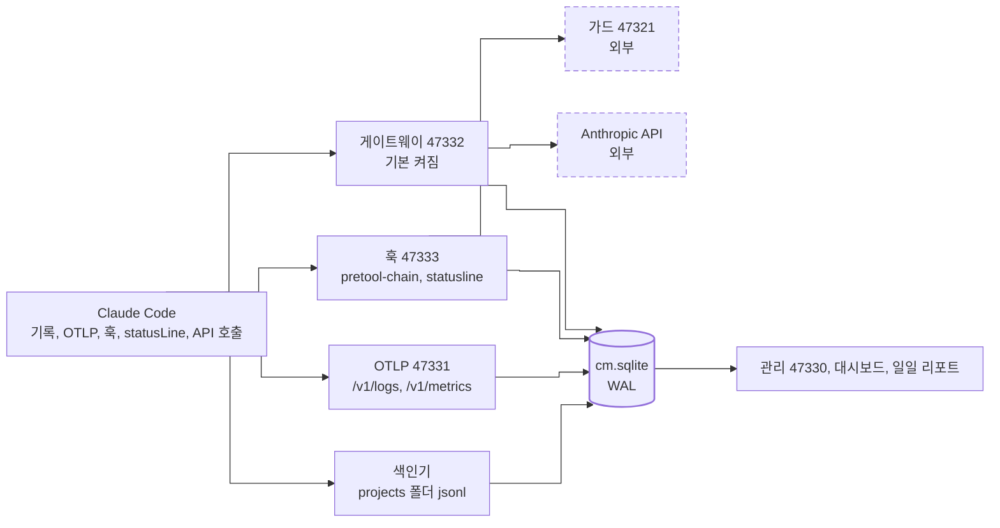
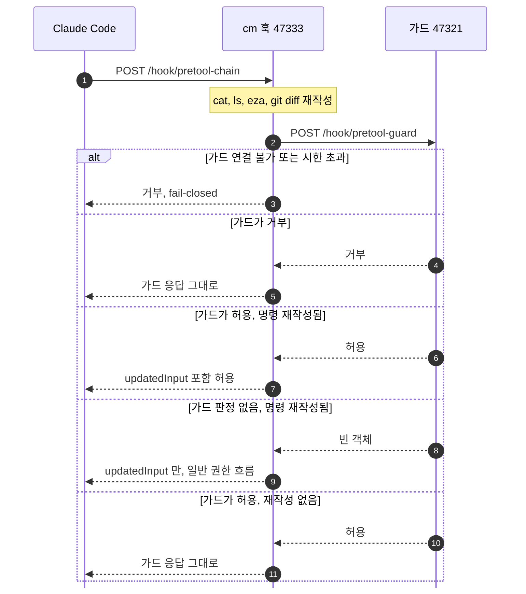

# Architecture

## 소스 트리

```markdown
claude-monitor/
├── src/
│   ├── main.rs : 실행 진입점, clap 명령(serve, start, tui, index, report, hook, statusline, status, doctor), 명령 없이 실행 시 동작(분리 serve 기동 후 대시보드), 종료 코드(status --once는 0 정상, 10 경고, 11 한도, 20 알 수 없음, 30 오류)
│   ├── lib.rs : 라이브러리 루트, 공개 모듈
│   ├── core/
│   │   ├── mod.rs : core 모듈 묶음
│   │   ├── config.rs : config.toml 로더(~/.config/claude-monitor/config.toml), 포트·게이트웨이·훅·색인기·리포트 설정, 데이터 폴더(기본 ~/.config/claude-monitor로 config.toml과 같은 폴더이며 CM_DATA_DIR로 변경)와 Claude 홈 결정, 리포트 언어, [pricing] 단가 덮어쓰기(검증 후 프로세스 전역 OnceLock에 한 번 설치하며 비용 추정이 읽음)
│   │   ├── context.rs : 모든 포트와 작업이 공유하는 AppContext, 실시간 카운터, 실시간 이벤트 broadcast 채널
│   │   └── model.rs : 기록 행 형태(5분·1시간 캐시 쓰기 분리, project, git_branch를 가진 ApiRequestRow와 OtelEventRow), DataSource, HookOutcome, LiveEvent(Otel 포함), 상태 스냅샷, 거부 재왕복 상수
│   ├── serve/
│   │   └── mod.rs : serve 진입, 포트 바인드 보유, 배경 분리 기동(serve.log), 저장소와 관리 토큰 준비, 주·게이트웨이 런타임, 작업 감독, 종료
│   ├── statuscheck/
│   │   ├── mod.rs : status --once: 최신 한도 스냅샷을 읽기 전용으로 판정(ok, warn, limit, unknown, error), 종료 코드, JSON 한 줄, 선택적 상태 파일 원자적 쓰기, serve 없이 동작
│   │   └── tests.rs : 판정 수준, 종료 코드, 상태 파일, 인자 테스트
│   ├── statusline/
│   │   ├── mod.rs : statusline 명령: stdin에서 한도·컨텍스트·캐시 지표 추출, 250 ms 예산 안에 훅 포트로 전송, 한 줄 출력, 기존 statusline 명령 감싸기 선택
│   │   └── tests.rs : 추출, 감싸기, 전송 실패 테스트
│   ├── store/
│   │   ├── mod.rs : SQLite 스키마, WAL, 백필 표식을 남기는 멱등 열 추가 마이그레이션, 중복 제거 적재 묶음 기록, 색인 커서, 일일·주간 리포트 보관
│   │   ├── limits.rs : limit_snapshots 테이블, LimitSnapshot, 중복 제거(값 변경 또는 1분), 기록할 때 정리하는 30일 보관, 최신·기록 조회
│   │   ├── ratelimit.rs : 게이트웨이 응답 헤더로 채우는 ratelimit_snapshots 테이블, 기록할 때 정리하는 30일 보관(기준 시각은 limits.rs와 공유)
│   │   ├── power.rs : standby_gaps 테이블, 구간 저장·불러오기·보관 상한
│   │   ├── metrics.rs : metric_points 테이블, 고유 식별 인덱스와 INSERT OR IGNORE 적재, 차원별 비용·토큰 귀속
│   │   ├── otel_events.rs : otel_events 테이블, 적재, 컴팩션·서브에이전트 조회
│   │   └── query.rs : 관리 API·대시보드·리포트 공용 집계(프로젝트·브랜치 통계 포함, 백분위와 함께 도구·훅의 평균·최대·합계 소요 시간과 모델 대기의 평균·최대·합계), 내장 단가표와 [pricing] 덮어쓰기로 요청 단위 비용 추정
│   ├── net/
│   │   ├── mod.rs : localhost HTTP 포트 묶음
│   │   ├── common.rs : 127.0.0.1 서버 루프, Host·Origin·Sec-Fetch-Site 거부, 응답 공용 형태
│   │   ├── admin/
│   │   │   ├── mod.rs : 관리 경로, 토큰 검사, 집계, 재색인, 리포트
│   │   │   ├── events.rs : 실시간 이벤트 Server-Sent Events 스트림
│   │   │   ├── client.rs : 대시보드·status용 블로킹 HTTP/1.1 관리 클라이언트
│   │   │   ├── tests.rs : 관리 클라이언트, 토큰, 집계, SSE 테스트
│   │   │   └── test_support.rs : 네트워크 테스트용 임시 저장소, 빈 포트, 원시 요청
│   │   ├── otlp/
│   │   │   ├── mod.rs : OTLP 수신(http/json 또는 http/protobuf, gzip, 크기 상한): 로그는 행으로, 지표는 메모리의 누적 추적기(기준값은 적재가 커밋된 뒤에 반영)를 거쳐 지표 점으로, 트레이스는 계수만
│   │   │   ├── mapping.rs : 로그 레코드를 행으로 변환(api_request, tool_result, hook_execution_complete와 otel_events 여섯 종류), 속성 일부만 사용
│   │   │   ├── proto.rs : 로그·지표 요청을 OTLP/JSON 값으로 바꾸는 직접 작성한 protobuf 와이어 해석기(중첩 깊이 32, 노드 2,000,000개 상한)
│   │   │   ├── metrics.rs : claude_code.* Sum·Gauge 점을 metric_points 행으로 변환, 누적은 증분으로 환산, user.*·organization.* 속성은 버림
│   │   │   ├── tests.rs : fixture 변환, 키 대체, 서버 검사
│   │   │   ├── metrics_tests.rs : 지표 변환, 누적 추적기, 엔드포인트 테스트
│   │   │   └── live_tests.rs : tests/fixtures/otlp-live/의 실제 수집 fixture로 변환 점검
│   │   └── gateway/
│   │       ├── mod.rs : Anthropic API 중계, 헤더 복사, 상류 호출
│   │       ├── proxy.rs : 상류 커넥터: 환경변수의 HTTPS_PROXY·NO_PROXY, http:// 프록시로 가는 HTTP CONNECT 터널(선택적 basic 인증), 루프백과 NO_PROXY 대상은 직접 연결, TLS 커넥터가 감싸는 tower-service 커넥터
│   │       ├── proxy/
│   │       │   └── tests.rs : 프록시 주소, NO_PROXY, CONNECT 협상 테스트
│   │       ├── tap.rs : 응답 계측, 첫 바이트·첫 토큰 시각, 5분·1시간 캐시 쓰기 분리를 읽는 SSE 사용량 파서, rate-limit 스냅샷 기록
│   │       ├── decode.rs : 계측 사본만 gzip·deflate 증분 해제
│   │       ├── ratelimit.rs : retry-after와 anthropic-ratelimit-* 응답 헤더 추출
│   │       └── tests.rs : 청크 경계 파싱, 계측 기록, 상류 오류, hop-by-hop 헤더
│   ├── hooks/
│   │   ├── mod.rs : 훅 서버 경로, 요청 상한
│   │   ├── chain.rs : pretool-chain 판정, 가드 응답 합성, fail-closed
│   │   ├── rewrite.rs : 보수적 Bash 재작성(cat, ls, eza, git diff)
│   │   ├── relay.rs : 다른 훅 경로의 계측 중계
│   │   ├── standby.rs : 대기 안내 경로, 도구 실패·프롬프트에 additionalContext 응답
│   │   ├── statusline.rs : statusline 경로: 전송된 지표 검증, 서버 시각 부여, 한도 스냅샷 저장, 훅 이벤트 행은 만들지 않음
│   │   ├── upstream.rs : 가드로 가는 keep-alive HTTP 클라이언트와 마감 시한
│   │   ├── record.rs : 카운터, 실시간 이벤트, 응답 경로 밖 저장소 기록
│   │   ├── client.rs : 블로킹 HTTP 클라이언트와 hook 명령
│   │   ├── chain_tests.rs : 가짜 가드 서버를 쓴 체인 테스트
│   │   └── statusline_tests.rs : statusline 경로 테스트(저장, 생략, 형식 오류)
│   ├── transcript/
│   │   ├── mod.rs : 증분 색인기, 1회 실행, 주기 루프
│   │   ├── files.rs : projects 폴더의 최근 jsonl 탐색
│   │   ├── scan.rs : 오프셋 이후 완결 줄 읽기, 행 생성(프로젝트 폴더 이름, git 브랜치, 5분·1시간 캐시 쓰기 분리)
│   │   ├── lines.rs : 줄 최소 역직렬화(cwd, git 브랜치, 캐시 쓰기 분리), 가드 거부 문구 판독
│   │   ├── tests.rs : 합성 기록 색인 테스트
│   │   └── test_support.rs : 임시 폴더와 테스트 설정
│   ├── report/
│   │   ├── mod.rs : 일일·주간 리포트 생성, 보관, 파일 기록, 예약
│   │   ├── render.rs : 집계를 박스 표가 있는 Markdown(report.language에 따라 한국어 또는 영어)으로 변환, 규칙 기반 제안
│   │   ├── text.rs : 리포트 언어별 문구 표와 자리표시자 채움
│   │   ├── weekly.rs : ISO 주(월~일) 자료 수집, 주 키 형식·해석, 주간 Markdown
│   │   ├── table.rs : 가벼운 선 박스 표 렌더러(한글 폭 2)와 파이프 표를 박스 표로 바꾸는 변환
│   │   └── tests.rs : 색인, 집계, 리포트 흐름과 예약 시각
│   ├── inventory/
│   │   ├── mod.rs : 훅·MCP·에이전트·스킬·env 키 목록 형태, doctor 진입
│   │   ├── load.rs : settings.json, 플러그인 hooks.json, .claude.json, 에이전트·스킬 머리글 읽기, 값 제외
│   │   ├── doctor.rs : 데이터 폴더, 포트, 중계 대상, 훅 등록, 허용 URL, 텔레메트리, 게이트웨이, projects 폴더 점검
│   │   └── tests.rs : fixture Claude 홈을 쓴 목록·진단 테스트
│   ├── power/
│   │   ├── mod.rs : 대기 감시 스레드, 절전 유예 요청(Win32 직접 선언), 시작 시 저장소에서 복원하고(실패했으면 다음 구간 기록 전에 저장된 최대 번호를 다시 읽음) 별도 스레드에서 저장하는 대기 구간 기록, 안내 문구
│   │   └── tests.rs : 대기 감지, 유예 유지·해제, 안내 대상 선택, 훅 응답 테스트
│   └── tui/
│       ├── mod.rs : 터미널 진입·복원, 변화 시에만 다시 그리는 이벤트 루프(AppState::tick 호출, 대기 시간을 누름 마감까지로 줄임), 시작 시 상태 불러오기, 오늘이 자정을 넘으면 시계를 따라감, SaveState는 터미널 가드가 소유한 상태 저장 스레드에 쓰기를 맡김, 명령 전달, 크기 변경 시 카드 이동 취소
│       ├── state.rs : 탭, 카드 포커스·배치·스크롤, 구간, 표시 언어, 누름·이동 상태, 패널 데이터, 키 처리(Shift+방향키, l, L), 스냅샷 교체 시 선택 유지
│       ├── cards.rs : 카드 식별자·종류, 카드별 스크롤·선택, 클릭 동작, 마우스 적중 영역(그려진 격자 줄 포함), 스크롤바 썸 계산
│       ├── layout.rs : 카드 배치: 탭별 격자·격자 비율 보관(grid_of, set_grid, reset_tab, grid_ratio_entries, restore_grid_ratios), arrange_tab(화면 줄 계획, 줄 높이·카드 폭 분할, 경계 드래그 영역, 카드 사각형)
│       ├── layout/
│       │   └── grid.rs : 탭별 카드 격자: 기본 줄, 카드 키, 반응형 화면 줄 계획(plan_lines), 놓기 위치 판정(resolve_drop), 카드 이동 연산(apply_drop, shift_card)
│       ├── card_move.rs : 카드 이동 상태 기계(impl AppState): 제목 400 ms 길게 누름, 격자 미리보기, 확정, 취소, Shift+방향키 이동, 시각은 Instant 인자(AppState::tick)로 받아 테스트가 시계를 주입
│       ├── tab_move.rs : 탭 순서 이동(impl AppState): 그려진 탭 폭으로 끌기 미리보기, end_drags 로 확정, Esc 취소, < > 한 칸 이동
│       ├── layout_store.rs : 홈 설정 폴더의 상태 파일 tui.toml(카드 격자는 [grids], 비율은 [grid_ratios], 열 폭): 시작 시 불러오기, 이전 파일의 [orders]·[ratios] 항목을 격자 형식으로 변환(LEGACY_GROUPS, [grids] 항목이 없는 탭에만 적용)하고 원본의 `.bak` 복사본 하나 남김, [grids]의 없앤 카드 키는 알림 없이 버림(RETIRED_CARD_KEYS), 상태 문자열과 저장 요청 만들기, 원자적 쓰기(임시 파일 후 이름 바꾸기, 심볼릭 링크 사슬은 최대 16단계까지 먼저 풀어 모든 링크 유지), 시작 시 오래된 임시 파일만 삭제(10분 넘게 수정되지 않은 것, 실행 중 프로세스 것은 제외), 맞지 않는 항목은 알림 한 번과 함께 건너뜀, 읽을 수 없는 파일은 `.bak`으로 복사
│       ├── state_writer.rs : 상태 저장 스레드: 경로별 최신 요청하나로 합치는 저장 요청 채널, Drop 시 남은 요청 쓰기와 스레드 합류(최대 5초만 기다리고 터미널 가드가 stderr에 경고), 실패는 UiMessage::StateSaveFailed로 돌려보냄
│       ├── i18n.rs : 항목마다 영어·한국어 문구를 둔 문구 카탈로그(기본 영어), 값이 들어가는 문구의 형식 함수, 도움말 줄
│       ├── mouse.rs : 호버, 클릭, 제목 누름, 줄 높이·카드 폭·열 폭 경계 드래그, 격자 카드 이동 미리보기·확정, 휠, 스크롤바 트랙 클릭·썸 드래그, 버튼 없는 움직임·새 누름·탭 전환·크기 변경이 모든 끌기를 뗌과 같게 끝내고 움직인 끌기는 저장
│       ├── poller.rs : 배경 수집(첫 수집 전 Store::open_store 스키마 갱신과 실패 시 오류 알림 전달, 무거운 패널은 10초마다이며 프로젝트·스킬·귀속 입력 포함, 캐시 타이머 카드용 최신 한도 스냅샷은 매 수집에 함께 옴), 설정·일일·주간 리포트·관리 요청 스레드
│       ├── format.rs : 숫자·시간·토큰 서식, 표시 폭 맞춤, 카드 제목 구간 맞춤
│       ├── sort.rs : 표 정렬 열 상태
│       ├── theme.rs : 다크 팔레트(최상단 고정 상태는 경고와 다른 전용 채움, API를 포함한 모든 이벤트 종류는 강조색과 다른 자기 인덱스 색)
│       ├── win_ctrl.rs : 창 항상 위 고정, 클래식 콘솔 글꼴 적용·복원(Win32 직접 선언)
│       ├── test_support.rs : 합성 설정과 스냅샷
│       └── views/
│           ├── mod.rs : 화면 조립, 앱 바(배지만), 탭 바(아홉 탭, 좁으면 간격 제거, 번호 붙인 압축 이름, 여백 제거 순), 하단 줄, 도움말 겹침
│           ├── common.rs : 카드 틀, 패널 상태, DB 빈 상태, 스크롤 표 카드(열 맞춤 규칙, 보조 줄 영역, 한 줄 카드의 머리글 생략)와 텍스트 카드, 카드 스크롤바(본문이 한 줄이면 한 칸 썸), 경계 손잡이
│           ├── overview.rs : 상태 헤더, KPI 카드, 훅 재작성 효과 카드(첫 줄에 순효과, 둘째 줄에 절약 시간과 손실 추정), 분당 스파크라인 카드, 실시간 이벤트 피드와 상세, 카드마다 크기 조건을 rank와 reserve와 함께 격자에 넘겨 높이가 모자라면 차트 줄이 먼저, 그다음 추이 줄이 숨겨짐
│           ├── charts.rs : 개요 차트 카드: 분당 활동 선 그래프(ratatui Chart, 사분 블록 표식, 이름이 붙은 범례), 토큰 구성·도구 호출 상위 막대 카드
│           ├── feed.rs : 실시간 이벤트 피드 표 열과 행 칸, 상세 줄과 같은 종류 맥락 줄
│           ├── tables.rs : 도구·훅 탭: 표 카드(도구: 호출, 오류, 평균, 최대, 합계, 오류율, 시간 비중, 훅: 횟수, 평균, 합계, 절약 시간, 비중)와 상세 카드
│           ├── models.rs : 모델·에이전트 탭: 통계 표(평균·합계 대기, 추정 비용, 마지막 시각, 모델 표에는 요청당 토큰), 상세 카드, 캐시 붕괴 후보, 캐시 타이머 카드
│           ├── projects.rs : 프로젝트 탭: 프로젝트·브랜치별 사용량 표(대기 합계, 요청당 토큰), 상세 카드, 스킬·MCP 서버·플러그인·에이전트·모델별 비용 귀속 표
│           ├── skills.rs : 스킬 탭: 설치 목록, Skill 도구 호출, OTel 비용을 이름으로 합친 스킬 표와 상세 카드
│           ├── settings.rs : 훅·MCP·에이전트·진단 표 카드와 보조 줄
│           ├── report.rs : 일일·주간 리포트 뷰어
│           └── render_matrix.rs : 버퍼 렌더 점검(테스트 전용): 모든 탭을 두 언어로 60x16, 100x30, 130x40에서 확인, 정확한 칸, 적중 영역, 소스 규칙 검사
├── tests/
│   └── fixtures/ : 단위 테스트가 읽는 fixture Claude 홈(inventory), 기록, OTLP 페이로드, otlp-live/(실제 Claude Code OTLP 내보내기를 정리한 수집본과 README)
├── assets/icon/
│   ├── claude-monitor.webp, claude-monitor-small.webp : 무손실 WebP 원본(40 px 이상용 1024 px 타일, 32 px 이하용 256 px 육각형 크롭)
│   ├── build_icon.py : WebP 원본 두 개를 ImageMagick으로 다중 크기 ico로 변환
│   └── claude-monitor.ico : 생성된 아이콘, build.rs가 실행 파일에 삽입
├── docs/
│   └── config.example.toml : 기본값을 담은 전체 설정 예시
├── build.rs : 리소스 스크립트(아이콘, 영어 VERSIONINFO, asInvoker manifest)를 OUT_DIR에 만들고 타깃 아키텍처용 windres로 컴파일하며 COFF 머신 타입이 다른 오브젝트는 버림(선택 사항: 도구가 없으면 경고만), gnullvm용 libunwind.dll 복사
├── Cargo.toml : 패키지 메타데이터, 의존성, release 프로필(panic = "unwind")
├── README.md : 설치·사용 안내 (영어 원문)
├── README-ko.md : 사용 안내
├── ARCHITECTURE.md : 이 문서의 영어 원문
└── LICENSE.md : Apache-2.0
```

---

## 런타임 구성

1. **프로세스**
    - `serve`가 쓰기 가능한 데이터베이스와 모든 포트를 소유하는 유일한 상주 프로세스
    - `tui`, `start`, `status`, `doctor`, `index`, `report`, `hook`, `statusline`은 같은 exe의 단명 프로세스이며, `start`는 아래 런처 단계만 실행하고 대시보드 없이 종료
    - `statusline`은 Claude Code의 statusLine 명령으로, 지표를 훅 포트로 보내고 한 줄을 출력(데이터 흐름의 statusline 경로 참고)
    - `status --once`는 데이터베이스를 읽기 전용으로 열고(파일을 만들지 않음) 최신 한도 스냅샷을 판정하며 실행 중인 `serve`가 필요 없으며, `limit_snapshots` 표가 생기기 전에 만든 데이터베이스는 오류가 아니라 알 수 없음(종료 코드 20)으로 보고
    - 런처: 명령 없이 실행하면 exe가 관리 포트를 확인하고, 응답하지 않으면 `serve`를 분리 실행(콘솔 없음, 허용되면 부모 Job 이탈, stderr는 `serve.log`)하고 최대 8초 포트를 기다린 뒤 런처 프로세스에서 대시보드를 실행
    - `tui`는 데이터베이스를 읽기 전용으로 열고, 서버 상태·재색인·리포트 생성에만 관리 API를 호출
    - `tui`의 수집 스레드는 첫 수집 전에 데이터베이스 파일이 있으면 `Store::open_store`를 한 번 호출해 이전 버전이 만든 DB가 읽기 전용 수집 전에 새 열을 갖추게 하며, 실패하면 오류 알림을 표시
    - `tui`가 쓰는 파일은 `~/.config/claude-monitor/`의 자기 상태 파일 `tui.toml`(`data_dir`를 옮겨도 `config.toml` 옆, 표시 언어, 카드 격자, 분할 비율, 열 폭) 하나뿐이며 대시보드 상태 절을 참고
    - `index`와 `report`는 자체 쓰기 연결을 열며, SQLite WAL 모드와 5초 busy timeout 덕에 `serve`와 함께 실행 가능
2. **serve 안의 런타임**
    - 메인 스레드는 `cm-main`이라는 multi-thread tokio 런타임에서 대기
    - 관리, OTLP, 훅(`hooks.enabled`일 때), 기록 색인기(`indexer.enabled`일 때), 리포트 스케줄러(`report.enabled`일 때)가 작업 하나씩으로 돌아감
    - 게이트웨이는 전용 OS 스레드 `cm-gateway`에서 worker 2개짜리 자체 multi-thread 런타임으로 실행하며, 기본 켜짐이고 `gateway.enabled = false`일 때만 생략
    - 이렇게 나누면 긴 스트리밍 중계가 훅·색인 부하와 섞이지 않음
    - `power.enabled`(기본값)이면 일반 OS 스레드 `cm-power`가 5초마다 돌며, `SetThreadExecutionState`는 절전 유예를 호출한 스레드에 묶으므로 이 스레드 하나가 설정과 해제를 모두 맡음
    - 시작할 때 이 스레드가 저장된 대기 구간을 기록으로 다시 불러오고, 새 대기 구간은 단명 스레드 `cm-power-save`가 `standby_gaps`에 기록하므로 DB 경합이 주기를 막지 않음
    - 그 복원이 실패하면 기록이 1부터 다시 세므로, 첫 구간 저장 때 다음 구간을 기록하기 전에 저장된 최대 번호를 다시 읽어 번호가 저장된 행과 겹치지 않게 함
3. **장애 격리**
    - release 프로필의 `panic = "unwind"`로 panic이 작업 하나 안에 머묾
    - 수락한 연결마다 별도 tokio 작업이므로 핸들러 panic은 그 연결만 끝냄
    - 기동 순서: 게이트웨이 상류를 검증하고, 관리, OTLP, 훅, 게이트웨이 순으로 포트를 바인딩해 서버가 인수할 때까지 유지하며, 그 뒤에야 저장소를 열고 `admin.token`을 기록하므로 관리 바인딩에 진 두 번째 `serve`는 토큰을 덮어쓰지 않음
    - 필수: 관리, 그리고 `hooks.enabled`일 때의 훅. 바인딩 실패나 둘 중 하나의 종료·panic이 있으면 `serve`가 0 이 아닌 종료 코드로 멈춤
    - `cm-power` 스레드 생성 실패는 출력만 하고 `serve`는 대기 감시 없이 계속 실행
    - 선택: OTLP와 게이트웨이. 바인딩 실패는 경고와 함께 그 서버를 건너뛰고, OTLP·색인기·리포트 스케줄러·게이트웨이 스레드의 종료는 로그와 warn `Notice` 실시간 이벤트로 알리고 `serve`는 계속 실행
    - `hooks.enabled = false`이면 훅 포트를 점유하지 않음
    - `Ctrl+C`가 대기 루프를 빠져나와 모든 작업을 중단
    - 대시보드는 배경 스레드의 panic을 종료 대신 패널 상태로 바꿈
4. **블로킹 작업**
    - SQLite 접근, 색인, 리포트 생성, 포트 점검은 `spawn_blocking`으로 실행
    - 훅 이벤트는 응답 경로 밖에서 저장소에 기록하고, 게이트웨이 tap은 응답 본문이 drop될 때 행을 기록
5. **공유 상태**
    - `AppContext`가 설정, 저장소, 실시간 이벤트 broadcast sender(용량 1024), 원자적 실시간 카운터, 시작 시각, 관리 토큰, `PowerState`(유예 여부, 마지막 주기 시각, 대기 구간 최대 32개와 안내한 세션·구간 쌍 최대 512개의 메모리 기록)를 가짐
6. **색인 주기**
    - 색인기는 `indexer.interval_secs`(30초)마다 블로킹 스레드에서 폴링하며 첫 실행은 실시간 이벤트를 내보내지 않음
    - 리포트 스케줄러는 첫 색인기 실행을 기다린 뒤(2초마다 확인, 최대 10분, 초과하면 warn 알림) 어제 리포트를 다시 만들며 보관된 것을 교체함
    - 그 뒤 예약된 일일 실행마다와 시작할 때 지난주 리포트(ISO 주, 월~일)를 보관본이 없거나 그 주가 끝나기 전에 만든 보관본(예를 들어 `g`로 만든 부분 본)이면 다시 만들고, 월요일 실행은 항상 덮어쓰며, 주간 리포트는 키 `YYYY-Www`로 보관하고 일일 파일 옆에 `<키>.md`로 기록

---

## 데이터 흐름

### 1. 출처에서 화면까지

1. **다이어그램**
    - Claude Code가 네 개의 수집 경로로 데이터베이스 하나에 쓰고, 세 가지 화면이 그것을 읽음



2. **기록 경로**
    - 색인기는 `indexer.backfill_days` 안에 수정된 `<claude_home>\projects\**\*.jsonl` 파일을 읽음
    - 파일마다 커서(크기, 수정 시각, 읽은 오프셋)를 두어 실행마다 증분으로 읽으며, 완결된 줄만 소비하고 줄어든 파일은 처음부터 다시 읽음
    - 행은 2000개씩 묶어 커밋
    - 요청 행은 5분·1시간 캐시 쓰기 분리, git 브랜치, 프로젝트(`cwd`의 마지막 폴더 이름, `.claude/worktrees` 아래 워크트리는 상위 프로젝트로 묶음)도 함께 가짐
3. **OTLP 경로**
    - Claude Code가 `/v1/logs`로 로그를, `/v1/metrics`로 지표를 `http/json` 또는 `http/protobuf`(gzip 선택)로 보내며 `/v1/traces`는 계수만 함
    - protobuf 본문은 `net/otlp/proto.rs`의 와이어 해석기가 같은 JSON 값 형태로 바꾸므로 매핑 하나가 두 형식을 모두 처리
    - 로그 이벤트 세 종류(`api_request`, `tool_result`, `hook_execution_complete`)는 요청·도구 호출·훅 행이 됨
    - 여섯 종류(`compaction`, `subagent_completed`, `api_error`, `api_retries_exhausted`, `tool_decision`, `permission_mode_changed`)는 `otel_events` 행과 `LiveEvent::Otel` 실시간 이벤트가 되며 그 밖의 로그 이벤트는 무시
    - `claude_code.*`의 Sum·Gauge 지표 점만 `metric_points` 행으로 남기고 히스토그램은 무시
    - 누적 합계는 프로세스 메모리에 둔 추적기로 증분이 됨: 계열의 첫 표본은 기준값일 뿐이고 값이 줄면 초기화로 보며, `serve`를 다시 시작하면 기준이 처음부터 다시 잡힘
4. **훅 경로**
    - Claude Code가 PreToolUse 페이로드를 `/hook/pretool-chain`으로 보내며, 판정은 다음 다이어그램에 나옴
    - 사용자가 등록하면 Claude Code가 PostToolUseFailure와 UserPromptSubmit 페이로드를 `/hook/standby-hint`로 보내며, 이 경로는 메모리의 대기 구간 기록을 읽고 훅 이벤트 행 하나를 기록
5. **대기 경로**
    - 주기마다 벽시계를 이전 주기와 비교하며, `power.gap_threshold_secs`를 넘는 도약은 최신 대기나 절전으로 프로세스 전체가 멈췄던 구간이므로 대기 구간으로 봄
    - 활동 표식은 게이트웨이 요청 카운터와 훅 호출 카운터의 합이며, 표식이 바뀌거나 게이트웨이 스트림이 열려 있으면 `power.awake_grace_secs` 동안 절전 유예를 유지
    - 각 대기 구간은 직전 주기가 활동에서 `power.awake_grace_secs` 안이었는지를 `active`로 가지며, 벽시계 역행은 활동 없음으로 봄
    - 실패 안내는 `active`와 관계없이 도구 실행 구간(`duration_ms`에 주기 한 번을 더한 구간)과 겹친 대기 구간을 담고, 프롬프트 안내와 `duration_ms` 없는 실패의 조건부 안내는 `power.hint_window_secs` 안에 끝난 `active` 구간을 세션·구간 시작 시각마다 한 번 담음
    - 감시 스레드가 기준보다 오래 주기를 돌지 않았으면 안내 경로는 마지막 주기 이후를 마지막 주기의 `active`를 가진 진행 중 대기 구간으로 보며, 나중에 기록되는 구간과 시작 시각이 같으므로 대기 한 번에 프롬프트 안내가 두 번 붙지 않음
    - 감시 스레드는 새 주기 시각을 저장하기 전에 대기 구간을 기록하므로, 그 사이에 도착한 훅도 진행 중 구간이나 기록된 구간 중 하나를 봄
    - `cm-power` 스레드의 drop guard는 스레드가 끝나면 마지막 주기 시각을 0으로 두고 warn 알림을 보내므로, 멈춘 감시 스레드가 영구적인 진행 중 구간이 되지 않음
    - 기록한 대기 구간은 `standby_gaps`에도 저장되고(최신 1000개 보관) 시작할 때 최근 구간을 기록으로 다시 불러오므로 재시작 뒤에도 안내 이력이 유지됨
6. **게이트웨이 경로**
    - 응답 본문을 감싼 tap이 본문이 끝나거나 drop될 때, 중단된 경우도 포함해 시간과 토큰 사용량을 기록
    - `POST /v1/messages`만 계측하며, 첫 `content_block_delta` 이벤트가 첫 토큰 시각
    - 상류 커넥터는 게이트웨이 상태를 만들 때 `HTTPS_PROXY`(`https_proxy`)와 `NO_PROXY`(`no_proxy`)를 한 번 읽고, 터널은 루프백 호스트도 `NO_PROXY` 대상도 아닌 https 상류에만 열며 TLS는 그 터널 위에서 수행
    - `http://` 프록시 주소만 받으며(스킴 생략은 http, 포트 생략은 80) `user:password@`는 `Proxy-Authorization: Basic` 헤더가 되고, 다른 스킴이나 형식이 틀린 주소는 사용 불가로 보관하므로 프록시가 필요한 요청은 직접 연결하지 않고 `502`로 실패
    - `NO_PROXY` 항목은 쉼표 목록의 한 칸이며 대소문자를 가리지 않고 호스트 전체나 점 경계의 도메인 접미와 맞춤(앞의 `.`와 `*.`는 뗌), `*`는 전체, 포트는 무시, IP 주소는 정확 일치이며 CIDR과 `ALL_PROXY`는 없음
    - CONNECT 협상은 15초 시한이 있고, 터널 본문을 삼키지 않도록 응답을 한 바이트씩 8 KiB까지 읽으며 HTTP/1.x 2xx 상태만 받음: 시작 알림과 오류에는 프록시 호스트만 나오고 자격 증명과 응답 문구는 나오지 않음
    - 상류 연결 오류는 `502`, 응답 헤더가 `gateway.upstream_timeout_secs` 안에 오지 않으면 `504`를 반환하며, 스트리밍 본문에는 시한이 없음
    - Claude Code의 `env`에 `ANTHROPIC_BASE_URL=http://127.0.0.1:47332`(와 `ANTHROPIC_DEFAULT_HAIKU_MODEL`)를 두면 Claude Code 자신의 API 트래픽이 이 경로를 지남
    - gzip·deflate 응답은 tap이 쓰는 사본만 해제하고 클라이언트에는 항상 원본 바이트를 전달하며, 그 밖의 인코딩(br, zstd, 다중 인코딩)은 사용량을 읽지 않음
    - 계측한 응답의 헤더에 `retry-after`나 `anthropic-ratelimit-*`가 있으면(`429`는 항상) 모델이 확정된 뒤 행과 함께 `ratelimit_snapshots` 행 하나를 저장
7. **statusline 경로**
    - Claude Code가 statusLine 명령 `claude-monitor statusline`을 실행하고 JSON을 stdin으로 전달
    - 명령은 최대 1 MiB만 읽고 한도·컨텍스트·캐시·모델·세션 id·비용 필드만 추려 훅 포트의 `/hook/statusline`으로 250 ms 예산 안에 전송하며, 전송 실패는 출력을 바꾸지 않음
    - `5h 42% | 7d 18% | ctx 63%` 같은 한 줄을 출력하고, `--wrap`이면 기존 statusline 명령을 같은 stdin으로 실행해 그 출력을 그대로 통과시키고 `--append`는 그 출력 뒤에 한 줄을 붙임
    - 경로는 서버 시각을 붙여 `limit_snapshots` 행을 저장하고 훅 이벤트는 기록하지 않으며 `hooks.enabled`가 필요
    - 같은 세션의 직전 행과 같고 60초 미만으로 새 행은 건너뛰므로 변하지 않은 값은 최대 1분에 한 번 저장
    - `status --once`는 5시간 또는 주간 값이 있는 가장 최근 스냅샷을 읽으며 리셋 시각이 지난 창은 비어 있는 것으로 봄
8. **화면**
    - 관리 API, 대시보드, 리포트는 모두 `store/query.rs`의 같은 집계 쿼리를 읽음
    - 대시보드는 키 `1`-`9`의 아홉 탭(개요, 도구, 훅, 모델, 에이전트, 설정, 리포트, 프로젝트, 스킬)이며 게이트웨이 탭은 없음: 게이트웨이 지연은 `GET /api/gateway`와 리포트로 계속 볼 수 있고, 개요의 서버 상태 카드는 게이트웨이 포트를 상태 점으로 표시
    - 모델 탭의 캐시 타이머 카드는 최신 `limit_snapshots` 행(프롬프트 캐시 만료, 적중률, 최근 미스)을 읽고 30분보다 오래된 스냅샷은 흐리게 표시하며, 스냅샷이 없으면 statusLine 설정 안내를 보여 줌
    - 프로젝트 탭은 집계 쿼리의 프로젝트·브랜치별 사용량과 `metric_points`의 스킬·MCP 서버·플러그인·에이전트·모델별 비용 귀속을 보여줌
    - 관리 API에 `GET /api/projects`, `/api/limits`(최신 스냅샷과 최신 100행까지의 기록, 오래된 것부터), `/api/ratelimit`(`extra_json`은 객체로 돌려줌)가 추가되고, `/api/report`는 `date=YYYY-MM-DD` 외에 `week=YYYY-Www`를 받고, `POST`는 그 요청에 한해 `[report] language`를 대신하는 선택 값 `lang=ko|en`을 받음
    - 리포트 탭은 일일·주간 보기를 전환하며 당일·이번 주는 보관본 대신 읽기 전용 DB로 바로 만들며, 대시보드의 오늘은 자정을 넘으면 시계를 따라가므로 오늘이나 이번 주를 보던 화면은 새 날·새 주로 옮겨 가고 지난 날·지난 주는 그대로 둠
    - 리포트 탭은 표시 언어를 따름: 대시보드가 리포트 적재·생성 요청에 리포트 언어를 표시 언어로 바꾼 설정 사본을 넘기고(생성 요청은 `lang`으로 실어 보냄), 리포트 탭에서 언어를 바꾸면 본문을 다시 적재하며, 예약 생성 리포트는 `[report] language`를 유지
    - 실시간 이벤트는 관리 SSE 스트림이 읽는 broadcast 채널로 흐르며, 실시간 카운터는 별도의 원자적 값

### 2. pretool-chain

1. **다이어그램**
    - 체인은 재작성하고, 가드에 묻고, 응답을 합성함



2. **규칙**
    - 가드는 재작성이 적용된 경우 원본이 아니라 항상 최종 명령을 봄
    - cm는 가드가 주지 않은 판정을 만들지 않음: 명시 허용은 허용 유지, 판정 없음은 `permissionDecision` 없이 `updatedInput`만, `ask`는 `ask`와 `updatedInput`
    - 가드 응답이 자체 `updatedInput`을 담으면 재작성보다 그것이 우선
    - 재작성된 명령에 허용, 확인 요청, 거부 외의 판정(예: `defer`)이 오면 재작성을 버리고 같은 시한으로 원본 명령을 가드에 다시 보내며, 그 두 번째 응답을 그대로 반환하고 두 번째 호출이 실패하면 fail-closed
    - `>|`가 들어 있는 명령은 재작성하지 않음
    - 시한은 `hooks.guard_deadline_ms`(3000 ms)이며 `settings.json`의 훅 timeout 10초보다 충분히 짧음

---

## 대시보드 상태

1. **모듈**
    - `tui/i18n.rs`는 화면 문구 하나를 영어·한국어 문구를 담은 카탈로그 항목 하나로 두며, 기본은 영어이고 경로, 모델·도구 이름, 로그 문구 같은 값은 번역 없이 그대로 지남
    - `tui/card_move.rs`는 누름·이동 상태 기계를 담음: `AppState::tick(now)`가 제목 누름이 400 ms를 넘으면 마우스 움직임과 무관하게 이동 모드로 들여 보내며, 이벤트 루프는 실제 시각을, 테스트는 자체 `Instant`를 넘김
    - `tui/layout_store.rs`는 상태 파일을 불러오고 저장함: `AppState::load_tui_state`는 시작할 때 한 번, `AppState::build_state_save`는 루프가 `UiCommand::SaveState`를 처리할 때 파일 내용을 만들고 쓰기는 `tui/state_writer.rs`가 맡음
    - `tui/state_writer.rs`는 채널로 받는 쓰기 스레드 하나를 돌림: 같은 경로의 대기 요청은 최신 하나로 합쳐지고, 쓰기 실패는 `UiMessage::StateSaveFailed`로 돌아와 오류 알림이 되며, `TerminalGuard`가 터미널을 복원한 뒤 핸들을 놓아 어느 종료 경로에서든 마지막 대기 요청을 쓰고 스레드를 합류시키되 최대 5초만 기다리고 멈추지 않고 stderr에 경고를 남김
2. **카드 이동**
    - 모든 탭의 모든 카드를 옮길 수 있음: 탭은 카드 줄의 격자(`TabGrid`)이고, 한 줄에는 카드 최대 여섯 장, 한 탭에는 줄 최대 여섯 개가 들어가며, 서버 상태 카드도 다른 카드처럼 옮길 수 있음
    - 누름, 미리보기, 확정은 마우스 이벤트로 진행됨: 제목을 400 ms 누르면 이동 모드에 들어가고, 끌면 배치를 바로 미리 보여 주며(`resolve_drop`, `apply_drop`), 줄 안에 놓으면 포인터 위치에서 그 줄에 합류하고, 줄의 위·아래 테두리에 놓으면 그 자리에 새 줄을 만들며(카드 자신의 줄의 위 테두리는 줄 안으로 셈), 카드가 빠져 빈 줄은 사라짐
    - 놓으면 이동이 확정되고, 놓침이나 새 누름도 미리 보던 배치를 확정하며, `Esc`, 탭 전환, 크기 변경은 이전 배치로 복원
    - `Shift+Left`, `Shift+Right`는 포커스 카드를 줄 안의 이웃과 맞바꾸고, `Shift+Up`, `Shift+Down`은 카드를 자기만의 새 줄로 옮기기와 이웃 줄에 합류하기를 번갈아 하고(`shift_card`), `l`은 탭의 기본 배치를 복원
    - 줄 높이 경계와 카드 폭 경계는 계속 끌 수 있으나, 다음 줄로 넘어간 줄의 폭 경계는 `arrange_tab`이 폭 잡기 없이 남김
    - `plan_lines`는 폭에 다 들어가지 않는 줄을 카드를 빼지 않고 다음 줄로 넘기고, 높이가 모자라면 `rank` 순으로 줄을 숨김(차트 줄이 먼저, 그다음 추이 줄): 숨겨진 줄은 배치를 그대로 유지하다가 터미널이 커지면 돌아옴
    - 배치가 바뀔 확정, `Shift+방향키`, 프로젝트 탭의 `d`는 `UiCommand::SaveState`를 반환
    - 탭을 누르면 누르기 전 순서를 담은 `TabDrag`가 시작되고, 끌기마다 끄는 탭을 그려진 탭 폭과 간격으로 계산한 가로 범위가 포인터를 품는 첫 칸으로 옮기되 지금 칸이 여전히 품으면 그대로 두어 폭이 다른 탭끼리 앞뒤로 흔들리지 않음
    - `AppState::end_drags`가 놓음, 놓침, 새 누름, 크기 변경 때 바뀐 탭 순서를 확정하고 `Esc`는 누르기 전 순서로 복원하며, `<`, `>`는 현재 탭을 이웃과 맞바꾸고 둘 다 `UiCommand::SaveState`를 반환
3. **상태 파일**
    - `~/.config/claude-monitor/tui.toml`(`config.toml` 옆, `data_dir`를 옮겨도 그대로이며 홈을 찾지 못할 때만 `<data_dir>`, 이름은 `core/config.rs`의 `TUI_STATE_FILE_NAME`)에 `version = 1`, `language`, `attribution_dimension`(`d`로 고른 프로젝트 탭 차원이며 기본값인 스킬이 아닐 때만 기록하고, 순환 목록 밖의 값은 알림 한 번과 함께 건너뜀), `tab_order`(고정 탭 이름이며 기본 순서와 다를 때만 기록하고, 아홉 탭을 한 번씩 담지 않은 목록은 알림 한 번과 함께 건너뛰고, `skills`만 빠진 목록은 `ActiveTab::LATER_TABS`에 따라 스킬을 끝에 붙임), `[grids]`(탭마다 키 하나에 카드 이름의 줄 목록), `[grid_ratios]`, `[column_widths]`를 고정 탭·표 이름 키(`event_feed`, `tool_table`, `hook_table`, `model_table`, `cache_breaks`, `agent_table`, `settings_hooks`, `settings_mcp`, `settings_agents`, `settings_doctor`, `project_table`, `attribution_table`, `skill_table`)로 저장하며, 기본 배치와 다른 항목만 기록하고 길이가 맞지 않거나 512를 넘는 폭이 든 목록은 건너뜀
    - 같은 폴더의 임시 파일에 쓴 뒤 대상 위로 이름을 바꾸므로 쓰기가 중단돼도 기존 파일은 온전하고 입력 스레드에서는 실행되지 않음
    - `tui.toml`이 심볼릭 링크이면 저장이 링크 사슬을 끝까지(최대 16단계, 더 깊으면 저장 실패) 따라가 실제 파일 폴더에 임시 파일을 만들고 동기화한 뒤 링크가 아닌 실제 파일 위로 이름을 바꾸며, 시작할 때 남은 임시 파일 정리는 두 폴더를 모두 살피되 오래된 것(10분 넘게 수정되지 않았고 실행 중인 프로세스 id가 아닌 것)만 지워 다른 인스턴스의 진행 중 임시 파일은 남음
    - 읽을 수 없거나 다른 버전인 파일은 시작할 때 첫 저장이 덮어쓰기 전에 `tui.toml.bak`으로 복사
    - 파일이 없으면 기본값, 읽을 수 없는 파일·지원하지 않는 버전·맞지 않는 항목은 알림 한 번과 함께 건너뜀
    - 이전 빌드가 쓴 파일도 그대로 불러옴: 도구, 훅, 스킬, 모델, 에이전트, 프로젝트, 설정, 리포트 탭의 `[orders]`·`[ratios]` 항목은 격자 형식(`LEGACY_GROUPS`)으로 변환해 `[grids]` 항목이 없는 탭에만 적용하고, 개요는 추이 카드 두 장의 순서만 유지하고 나머지 옛 키는 알림 없이 버리며(`LEGACY_OVERVIEW_KEYS`), 맞지 않는 옛 값은 알림 없이 버리되 모르는 옛 키는 건너뛴 항목으로 세고, 옛 표는 다시 쓰지 않으며, 원본 파일에 `[orders]`나 `[ratios]`가 있을 때마다 `.bak` 복사본을 만들고, `[grids]`에 남은 없앤 카드 이름(`RETIRED_CARD_KEYS`: `kpi_wait`, `limits_card`, `chart_limits`)은 알림 없이 버리고, 파일 버전은 `version = 1`로 그대로이며, 이전 열 개수로 저장한 도구·훅·모델·프로젝트·스킬 표의 열 폭은 같은 열에 그대로 적용됨
    - 사용자별 파일은 모두 `~/.config/claude-monitor/` 아래에 있음(README의 데이터 폴더 참고)

---

## 데이터 저장소

1. **엔진**
    - 내장 라이브러리를 쓰는 `rusqlite` 기반 SQLite, mutex로 감싼 연결 1개, `journal_mode = WAL`, `synchronous = NORMAL`, `busy_timeout = 5000`
    - 대시보드 같은 조회 쪽은 자체 읽기 전용 연결을 엶
    - 시각은 RFC 3339 UTC 문자열이며 모든 집계 구간은 반열린 구간: `ts >= since AND ts < until`
2. **테이블**
    - `api_requests`: 모델 요청 1건, 고유 `request_key`, 출처, 모델, 에이전트, 세션, 토큰 카운터 4종, `cache_creation_5m_tokens`, `cache_creation_1h_tokens`, `duration_ms`, `first_byte_ms`, `first_token_ms`, `status`, `git_branch`, `project`(폴더 이름만)
    - `tool_calls`: 도구 호출 1건, 고유 `tool_use_id`, 도구 이름, 소요 시간, 오류 여부와 종류
    - `hook_events`: 훅 판정 1건, 고유 `event_key`, route, 가드 라벨, 결과, detail, 소요 시간, `saved_ms`
    - `sessions`: 세션 1개, 처음·마지막 시각과 프로젝트 폴더 이름
    - `index_cursors`: 기록 파일 1개, 크기, 수정 시각, 읽은 오프셋, 이어 읽기 상태
    - `daily_reports`: 키당 리포트 1건(날짜 `YYYY-MM-DD` 또는 ISO 주 `YYYY-Www`), 생성 시각과 Markdown
    - `limit_snapshots`: statusLine 표본 1건, 세션, 모델, 5시간·7일 퍼센트와 리셋 시각, 컨텍스트 사용량, 프롬프트 캐시 상태, 세션 비용, `ts`와 세션·`ts` 인덱스, 30일이 지난 행은 기록할 때 정리
    - `ratelimit_snapshots`: 응답 1건의 rate-limit 헤더, 종류별 limit·remaining·reset 값, `retry_after_secs`, 그 밖 `anthropic-ratelimit-*` 헤더를 담는 `extra_json`, 30일이 지난 행은 기록할 때 정리
    - `standby_gaps`: 대기 구간 1개, 시작·끝, `active`, 기록 시각, 최신 1000개 보관
    - `metric_points`: OTLP 지표 점 1개, 세션, 지표 이름, 토큰 종류, 모델, 쿼리 출처, 에이전트, 스킬, 플러그인, MCP 서버·도구 이름, 값, `temporality`(`delta` 또는 `gauge`), 이 열들과 시각·값 전체에 걸친 고유 인덱스로 적재는 `INSERT OR IGNORE`
    - `otel_events`: 새 여섯 종류의 OTLP 이벤트 1건, 고유 `event_key`, 세션, 에이전트, 종류, 이름, 상태, 소요 시간, 토큰 수, 횟수, 짧은 `detail`
3. **마이그레이션**
    - `Store::open_store`가 빠진 테이블과 인덱스를 만든 뒤 이전 DB의 `api_requests`에 새 열 4개를 `BEGIN IMMEDIATE` 트랜잭션 안에서 추가하며 이미 있는 열은 건너뜀
    - 열을 추가했을 때는 `index_cursors`의 모든 행도 삭제해 다음 색인기 실행이 백필 구간을 다시 읽어 새 열을 채우며, 두 번째 열기는 아무것도 추가하지 않고 커서를 유지
    - 같은 단계가 `index_backfill_pending` 표식을 남기며, 새 바이너리의 다음 색인기 실행이 커서를 한 번 더 비우고 표식을 지움
    - `serve`, `index`, `report`, 대시보드 시작(파일이 있을 때)은 모두 `open_store`로 데이터베이스를 열음
4. **묶음 기록**
    - `insert_batch`는 한 묶음을 단일 트랜잭션에서 API 요청, 도구 호출 시작, 도구 완료, 훅 이벤트, OTLP 이벤트, 세션 순으로 기록
5. **내용**
    - 프롬프트 본문, 명령 본문, 파일 내용, 인증 헤더를 담는 열은 어느 테이블에도 없으며 훅 행의 `detail`에는 짧은 명령 이름만 들어감
    - `ratelimit_snapshots.extra_json`에는 `anthropic-ratelimit-*`와 `retry-after` 헤더 값만 들어가고 `limit_snapshots` 행에는 경로나 폴더가 없음
    - `otel_events.detail`은 제어 문자를 바꾸고 200자로 자른 메타데이터이며, API 오류와 실패한 컴팩션은 자른 오류 문자열을 남김

---

## 출처 병합 규칙

1. **키**
    - `api_requests.request_key`: 기록은 message id, OTLP는 `otlp:<request_id>`(없으면 `client_request_id`, 그것도 없으면 세션·시각·순번), 게이트웨이는 `gw:<millis>:<counter>`
    - `tool_calls.tool_use_id`: 기록과 OTLP가 공유
    - `hook_events.event_key`: 훅 서버는 `hook-<millis>-<pid>-<seq>`, 기록은 `transcript:<tool_use_id>:deny`, OTLP는 `otlp:<세션>:<순번 또는 시각>:<훅 이름>`
    - `otel_events.event_key`: `otlp:<세션>:<에이전트>:<순번 또는 시각>:<이벤트 이름>`, 도구 판정은 `:<tool_use_id>`가 붙음
2. **같은 출처의 같은 키**
    - 더 큰 토큰 수나 더 긴 소요 시간으로 다시 도착한 API 요청은 저장된 행을 갱신하므로, 읽기 경계에서 나뉜 메시지도 최종 사용량으로 끝남
    - 5분·1시간 캐시 쓰기 수는 더 큰 값을 유지하고 `git_branch`와 `project`는 비어 있을 때만 채우므로 처음 값이 유지됨
    - 키가 이미 있는 도구 호출과 훅 이벤트는 무시하므로 먼저 쓴 쪽이 이김
    - 도구 완료는 `duration_ms`가 비어 있을 때만 시작·완료 시각 차이로 채움
3. **요청 합계**
    - 요청 수, 토큰 합계, 모델 대기, 모델·에이전트 사용량, 캐시 붕괴, 분당 추이는 `source = 'transcript'` 행만 읽으므로 같은 요청의 OTLP·게이트웨이 행이 두 번 세어지지 않음
    - 게이트웨이 지연은 `source = 'gateway'` 행만 읽고, 리포트는 출처별 행 수를 출력
4. **훅 거부**
    - 거부는 두 곳에서 보임: 기록의 거부된 도구 결과와 훅 서버
    - 집계는 이벤트 단위: 같은 세션에 훅 서버 거부보다 2초 앞부터 10초 뒤 사이의 기록 출처 거부가 있으면 그 훅 서버 거부는 빼고, 세션 id가 비어 있는 훅 서버 거부는 항상 셈
    - OTLP 거부 행은 저장하지만 집계에는 세지 않음
5. **출처 병합이 없는 테이블**
    - `limit_snapshots` 행은 같은 세션의 직전 행과 같고 60초 미만으로 새 경우에만 건너뜀
    - `ratelimit_snapshots` 행은 키 없이 항상 추가됨
    - `metric_points` 행은 고유 식별 인덱스(이름, 시각, 세션, 토큰 종류, 모델, 쿼리 출처, 에이전트, 스킬, 플러그인, MCP 서버·도구, temporality, 값)에 맞춰 `INSERT OR IGNORE`로 넣으므로 다시 보낸 지표 묶음은 두 번 세지 않음
    - 누적 합계는 먼저 증분으로 바뀌고 그 기준값은 적재가 커밋된 뒤에만 반영되며, 쓸 수 있는 값이 없는 점은 버려짐
    - `limit_snapshots`와 `ratelimit_snapshots`에서 30일(`LIMIT_SNAPSHOT_RETENTION_DAYS`)이 지난 행은 기록 시각과 현재 중 이른 쪽부터 거슬러 세어 기록할 때 삭제함
    - `standby_gaps`는 같은 id의 행을 교체함
    - 스킬·MCP 서버·플러그인·에이전트·모델별 귀속은 이름이 비지 않은 `cost.usage`·`token.usage`의 `delta` 점만 읽으며 위의 요청 합계와는 별개
6. **추정값**
    - 손실 시간은 거부 수에 4200 ms(거부 뒤 모델 재왕복의 7일 중앙값)를 곱한 값이고, 절약 시간은 재작성의 `saved_ms` 합
    - 비용은 토큰 카운터로 요청 단위 추정하며 내장 모델별 단가표를 씌: 모델 이름 접두어가 가장 긴 항목이 이기고, 5분·1시간 캐시 쓰기는 각자 단가가 있으며, 모델 하나는 프롬프트 크기 기준을 넘으면 더 높은 단가를 씀. 알 수 없는 모델은 0으로 셈
    - 표의 모든 단가는 2026-11-19에 공식 가격 페이지로 확인했음: `opus-4`(Opus 4와 4.1)는 100만 토큰당 15와 75 USD, Opus 4.5~4.8은 각자 5와 25 항목, `sonnet-4`(Sonnet 4와 날짜가 붙은 ID)는 3과 15이며 모두 표준 캐시 배수를 씀
    - 분리 열이 생기기 전에 저장된 행은 캐시 쓰기 합계만 가지며 이를 5분 쓰기 단가로 셈
    - `config.toml`의 `[pricing.models]` 항목은 키 접두어가 맞는 모든 모델의 내장 단가를 대체하며(가장 긴 키가 이기고 단일 단가), 덮어쓰기는 설정을 읽을 때 한 번만 적재하므로 바꾸면 재시작이 필요하며, 앞뒤 공백을 자르고 앞의 `claude-`를 뺀 뒤 비는 키는 적재할 때 거부됨
7. **캐시 붕괴**
    - 캐시 생성 토큰이 20,000 이상이면서 캐시 읽기가 직전 컨텍스트의 절반 미만인 요청이 후보
    - 직전 요청과의 간격으로 원인을 추정: 유휴 1시간 초과, 유휴 5분 초과(TTL), 모델 변경, 원인 미상의 prefix 변경

---

## 보안 경계

1. **네트워크 노출**
    - 모든 리스너는 IPv4 `127.0.0.1`에만 바인딩
2. **브라우저·rebinding 방어**
    - `net/common.rs`가 모든 포트의 모든 요청을 검사: `Host` 헤더는 `127.0.0.1:<포트>` 또는 `localhost:<포트>`여야 하고, `Origin`이나 `Sec-Fetch-Site` 헤더가 있으면 `403`으로 거부
3. **관리 토큰**
    - 관리 포트의 모든 `POST`는 `x-cm-token` 헤더가 필요
    - 토큰은 OS 난수 32 byte를 hex로 인코딩해 시작할 때마다 `admin.token`에 기록하며, 코드가 파일 권한을 따로 설정하지 않으므로 파일은 데이터 폴더의 접근 규칙을 상속
    - 비교는 `ring`의 HMAC-SHA-256 태그 검증이며 상수 시간이고 길이를 노출하지 않음
    - 새 집계를 포함한 `GET` 엔드포인트는 토큰이 필요 없으며 Host, Origin, Sec-Fetch-Site 검사 뒤에 있음
4. **fail-closed 체인**
    - 가드가 연결 불가, 시한 초과, 2xx 아님, JSON 객체 아님이면 거부하며 체인이 스스로 허용하는 경우는 없음
    - 등록 설정 `onFailure: "block"`이 체인 자체가 내려가면 Claude Code가 거부하도록 만듦
5. **입력 상한**
    - 훅과 OTLP 본문은 16 MiB(OTLP는 gzip 해제 후에도), 게이트웨이 요청은 64 MiB, 가드 응답은 8 MiB로 제한
    - 관리 클라이언트는 요청 값의 CR·LF를 거부하고, 훅 클라이언트는 `a-z`, `0-9`, `-`, `relay/<이름>` route만 받음
    - 지표 요청은 점을 최대 5000개만 만들고, 누적 추적기는 계열이 50,000개에 이르면 기준을 다시 잡으며, protobuf 해석기는 중첩 깊이 32와 노드 2,000,000개에서 멈춤
    - statusline 명령은 stdin을 최대 1 MiB만 읽고, statusline 경로는 512 byte를 넘는 문자열 필드를 거부하며, rate-limit 수집은 추가 헤더를 최대 32개, 각 128자만 남김
6. **게이트웨이**
    - 상류는 `https` 주소여야 하며 rustls가 내장 웹 PKI 루트로 검증
    - 프록시 자격 증명은 환경변수의 프록시 주소에서만 오고, 디버그 출력이 가리는 Basic 토큰으로만 보관하며 기록하지 않음
    - 요청 헤더의 인증 정보는 상류로만 전달하고 저장하지 않으며, 응답 본문은 모델과 사용량만 살핌
7. **설정 접근**
    - 목록은 훅 항목, MCP 이름, env 키 이름을 위해 `settings.json`과 `.claude.json`을 읽으며, env 값은 비교에만 쓰고 출력하거나 저장하지 않음
8. **자식 프로세스**
    - `serve::ensure_background_serve`는 `serve`와 같은 exe를 분리 실행하며, 명령 없이 실행하거나 `start`를 실행했을 때 관리 포트가 응답하지 않을 경우 한 번만 실행
    - `statusline --wrap`은 사용자가 `--` 뒤에 준 명령 하나를 띄워 같은 stdin을 주며, `build.rs`는 빌드 시점에 빌드 도구를 띄움
    - 훅 체인, 수집, 색인, 대시보드 경로는 아무것도 띄우지 않음
9. **OS 전원 요청**
    - 대기 감시의 OS import는 `kernel32!SetThreadExecutionState` 하나이며 `ES_CONTINUOUS | ES_SYSTEM_REQUIRED` 또는 `ES_CONTINUOUS`로만 호출하고, `ES_DISPLAY_REQUIRED`는 설정하지 않으므로 화면 끄기·잠금 정책은 그대로 동작
    - 대시보드는 `tui/win_ctrl.rs`에 창·콘솔 글꼴 호출(`user32`, `kernel32`)을 따로 선언하며, 대시보드를 실행하는 터미널 창만 건드림
    - 대기 안내 경로는 `hook_event_name`, `session_id`, `duration_ms`만 읽으며 오류 본문, 도구 입력, 프롬프트 본문은 저장값이나 로그로 읽어 들이지 않음
10. **개인정보 필터**
    - statusline 명령은 고정 경로로 필드를 고르며 `transcript_path`, `cwd`, 작업 공간, 세션 이름, PR, 워크트리 값은 읽거나 전송하거나 저장하지 않음
    - 기록 행은 `cwd`의 마지막 폴더 이름과 git 브랜치 이름만 남기고 전체 경로는 남기지 않음
    - OTLP 로그는 속성 일부만 변환하고, 지표는 차원이나 계열 키를 만들기 전에 `user.*`·`organization.*` 속성을 버림
    - 게이트웨이 rate-limit 수집은 `retry-after`와 `anthropic-ratelimit-*` 응답 헤더만 읽으며 authorization·API 키 헤더는 읽거나 저장하지 않음
11. **상태 파일 쓰기**
    - `status --once`는 `--state-file`을 준 때만 같은 폴더의 임시 파일과 이름 바꾸기로 파일을 쓰며, 위젯이 오래된 값을 믿지 않도록 오류 수준도 기록
