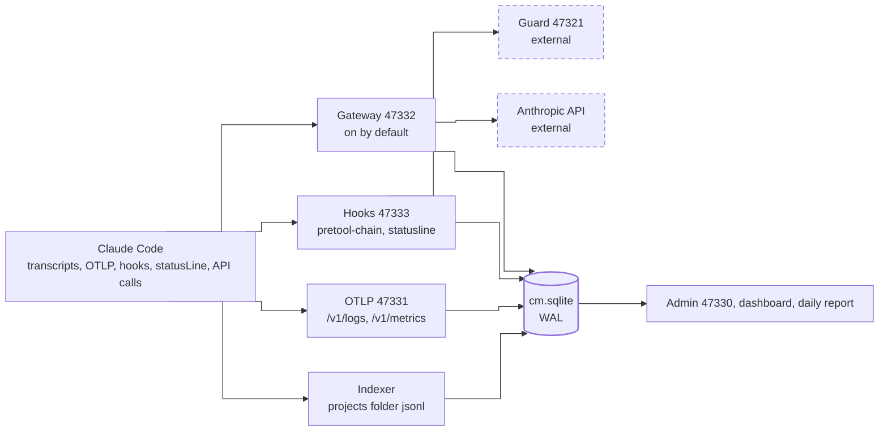
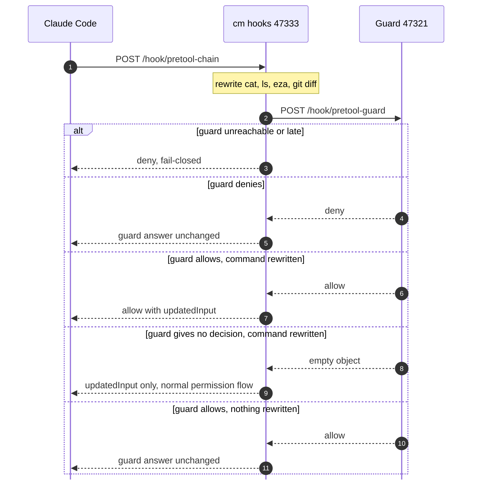

# Architecture

## Source Tree

```markdown
claude-monitor/
├── src/
│   ├── main.rs : binary entry, clap commands (serve, start, tui, index, report, hook, statusline, status, doctor), no-command launch (detached serve, then dashboard), exit codes (status --once: 0 ok, 10 warn, 11 limit, 20 unknown, 30 error)
│   ├── lib.rs : library root, public modules
│   ├── core/
│   │   ├── mod.rs : core module gateway
│   │   ├── config.rs : config.toml loader (~/.config/claude-monitor/config.toml), port, gateway, hook, indexer, and report settings, data directory (default ~/.config/claude-monitor, the folder of config.toml; CM_DATA_DIR overrides) and Claude home resolution, report language, [pricing] rate overrides (validated, installed once into a process-wide OnceLock that cost estimation reads)
│   │   ├── context.rs : AppContext shared by every port and task, live counters, live-event broadcast channel
│   │   └── model.rs : row types (ApiRequestRow with the 5m and 1h cache-creation split, project, and git_branch; OtelEventRow), DataSource, HookOutcome, LiveEvent (with Otel), status snapshot, deny round-trip constant
│   ├── serve/
│   │   └── mod.rs : serve entry, held port binds, detached background launch (serve.log), store and admin token setup, main and gateway runtimes, task supervision, shutdown
│   ├── statuscheck/
│   │   ├── mod.rs : status --once: read-only judgment of the latest limit snapshot (ok, warn, limit, unknown, error), exit codes, one JSON line, optional state file written atomically; works without serve
│   │   └── tests.rs : level, exit code, state file, and argument tests
│   ├── statusline/
│   │   ├── mod.rs : statusline command: extract limit, context, and cache metrics from stdin, post them to the hooks port within a 250 ms budget, print one line, optionally wrap an existing statusline command
│   │   └── tests.rs : extraction, wrapping, and delivery-failure tests
│   ├── store/
│   │   ├── mod.rs : SQLite schema, WAL, idempotent column migration with a backfill marker, batch insert with dedupe, index cursors, daily and weekly report storage
│   │   ├── limits.rs : limit_snapshots table, LimitSnapshot, dedupe (changed value or one minute), 30-day retention pruned on insert, latest and history queries
│   │   ├── ratelimit.rs : ratelimit_snapshots table filled from gateway response headers, 30-day retention pruned on insert (cutoff shared with limits.rs)
│   │   ├── power.rs : standby_gaps table, gap save, load, and retention
│   │   ├── metrics.rs : metric_points table, unique identity index with INSERT OR IGNORE, cost and token attribution by dimension
│   │   ├── otel_events.rs : otel_events table, insert, compaction and subagent queries
│   │   └── query.rs : aggregates shared by the admin API, dashboard, and report (including project and branch stats; average, maximum, and total durations of tools and hooks and average, maximum, and total model wait alongside the percentiles), per-request cost estimate from the built-in rate table and [pricing] overrides
│   ├── net/
│   │   ├── mod.rs : localhost HTTP ports gateway
│   │   ├── common.rs : 127.0.0.1 server loop, Host, Origin, and Sec-Fetch-Site rejection, response helpers
│   │   ├── admin/
│   │   │   ├── mod.rs : admin routes, token check, aggregates, reindex, report
│   │   │   ├── events.rs : Server-Sent Events stream of live events
│   │   │   ├── client.rs : blocking HTTP/1.1 admin client for the dashboard and status
│   │   │   ├── tests.rs : admin client, token, aggregate, and SSE tests
│   │   │   └── test_support.rs : temporary store, free ports, raw requests for network tests
│   │   ├── otlp/
│   │   │   ├── mod.rs : OTLP receiver (http/json or http/protobuf, gzip, size limits): logs to rows, metrics to metric points through the in-memory cumulative tracker (baselines applied after the insert commits), traces counted only
│   │   │   ├── mapping.rs : log record to row mapping (api_request, tool_result, hook_execution_complete, and six otel_events kinds), attribute subset only
│   │   │   ├── proto.rs : hand-written protobuf wire decoder that turns logs and metrics requests into OTLP/JSON values (nesting depth 32, 2,000,000 node limit)
│   │   │   ├── metrics.rs : claude_code.* Sum and Gauge points to metric_points rows, cumulative to delta, user.* and organization.* attributes dropped
│   │   │   ├── tests.rs : fixture mapping, key fallback, server checks
│   │   │   ├── metrics_tests.rs : metric mapping, cumulative tracker, and endpoint tests
│   │   │   └── live_tests.rs : mapping checks against the live-capture fixtures in tests/fixtures/otlp-live/
│   │   └── gateway/
│   │       ├── mod.rs : Anthropic API proxy, header copy, upstream call
│   │       ├── proxy.rs : upstream connector: HTTPS_PROXY and NO_PROXY from the environment, HTTP CONNECT tunnel to an http:// proxy with optional basic auth, direct connection for loopback and NO_PROXY matches, tower-service connector wrapped by the TLS connector
│   │       ├── proxy/
│   │       │   └── tests.rs : proxy address, NO_PROXY, and CONNECT negotiation tests
│   │       ├── tap.rs : response tap, first byte and first token timing, SSE usage parser with the 5m and 1h cache-creation split, rate-limit snapshot write
│   │       ├── decode.rs : incremental gzip and deflate decoding of the tap copy only
│   │       ├── ratelimit.rs : retry-after and anthropic-ratelimit-* response header extraction
│   │       └── tests.rs : chunk-boundary parsing, tap recording, upstream error, hop-by-hop headers
│   ├── hooks/
│   │   ├── mod.rs : hook server routes, request limits
│   │   ├── chain.rs : pretool-chain decision, guard answer synthesis, fail-closed
│   │   ├── rewrite.rs : conservative Bash rewrite (cat, ls, eza, git diff)
│   │   ├── relay.rs : instrumented relay of other hook routes
│   │   ├── standby.rs : standby hint route, additionalContext answer for tool failures and prompts
│   │   ├── statusline.rs : statusline route: validate the posted metrics, add the server timestamp, store a limit snapshot, no hook event row
│   │   ├── upstream.rs : keep-alive HTTP client to the guard with a deadline
│   │   ├── record.rs : counters, live event, off-path store write
│   │   ├── client.rs : blocking HTTP client and the hook command
│   │   ├── chain_tests.rs : chain tests against a fake guard server
│   │   └── statusline_tests.rs : statusline route tests (stored, skipped, malformed)
│   ├── transcript/
│   │   ├── mod.rs : incremental indexer, one-shot run, periodic loop
│   │   ├── files.rs : recent jsonl discovery under the projects folder
│   │   ├── scan.rs : read complete lines after an offset, build rows (project folder name, git branch, 5m and 1h cache-creation split)
│   │   ├── lines.rs : minimal line deserialization (cwd, git branch, cache-creation split), guard denial text reader
│   │   ├── tests.rs : indexer tests on synthetic transcripts
│   │   └── test_support.rs : temporary folders and test configuration
│   ├── report/
│   │   ├── mod.rs : daily and weekly report build, store, file write, schedule
│   │   ├── render.rs : aggregates to Markdown (Korean or English by report.language) with box tables, rule-based suggestions
│   │   ├── text.rs : phrase table per report language with placeholder fill
│   │   ├── weekly.rs : ISO week (Monday to Sunday) input collection, week key format and parse, weekly Markdown
│   │   ├── table.rs : light box-table renderer (Hangul width 2) and pipe-table to box-table conversion
│   │   └── tests.rs : index to aggregate to report flow, schedule time
│   ├── inventory/
│   │   ├── mod.rs : hook, MCP, agent, skill, and env-key inventory types, doctor entry
│   │   ├── load.rs : read settings.json, plugin hooks.json, .claude.json, agent and skill headers, no values
│   │   ├── doctor.rs : data directory, ports, relay target, hook registration, allowed URL, telemetry, gateway, projects folder checks
│   │   └── tests.rs : inventory and doctor tests on fixture Claude homes
│   ├── power/
│   │   ├── mod.rs : standby monitor thread, sleep postponement (direct Win32 declaration), gap ledger restored from the store at start (re-reading the stored max id before the next gap when that failed) and saved on a separate thread, hint text
│   │   └── tests.rs : gap detection, hold and release, hint selection, hook answer tests
│   └── tui/
│       ├── mod.rs : terminal setup and restore, redraw-on-change event loop (calls AppState::tick and shortens the wait to the press deadline), state load at start, today follows the clock across midnight, SaveState queues a write on the state writer thread owned by the terminal guard, command dispatch, resize cancels a card move
│       ├── state.rs : tabs, card focus, layout and scroll, window, display language, press and move state, panel data, key handling (Shift+arrow, l, L), selection kept across snapshots
│       ├── cards.rs : card ids and kinds, per-card scroll and selection, click actions, mouse hit areas (including the drawn grid lines), scrollbar thumb math
│       ├── layout.rs : card layout: per-tab grid and grid ratio storage (grid_of, set_grid, reset_tab, grid_ratio_entries, restore_grid_ratios), arrange_tab (screen line plan, row height and card width splits, boundary drag areas, card rectangles)
│       ├── layout/
│       │   └── grid.rs : per-tab card grid: default rows, card keys, responsive line planning (plan_lines), drop target (resolve_drop), card move operations (apply_drop, shift_card)
│       ├── card_move.rs : card move state machine (impl AppState): 400 ms title press, live grid preview, commit, cancel, Shift+arrow move; time comes in as an Instant argument (AppState::tick), so tests inject the clock
│       ├── tab_move.rs : tab reorder (impl AppState): drag preview from the drawn tab widths, commit through end_drags, Esc cancel, < > one-slot move
│       ├── layout_store.rs : state file tui.toml in the home config folder (card grids in [grids], ratios in [grid_ratios], column widths): load at start, conversion of an earlier file's [orders] and [ratios] entries to the grid form (LEGACY_GROUPS, only for a tab with no [grids] entry) with one `.bak` copy of the original, retired card keys dropped from [grids] without a notice (RETIRED_CARD_KEYS), state text and save request build, atomic write (temporary file, then rename; the whole symbolic link chain, 16 links at most, is resolved first so every link survives), start-up removal of stale temporary files only (older than 10 minutes, never the running process's), skip invalid entries with one notice, copy an unreadable file to `.bak`
│       ├── state_writer.rs : state writer thread: channel of save requests coalesced to the latest per path, flush and join on drop (waits at most 5 seconds, then reports it so the terminal guard warns on stderr), failures sent back as UiMessage::StateSaveFailed
│       ├── i18n.rs : message catalog with English and Korean text per entry (default English), format functions for texts with values, help rows
│       ├── mouse.rs : hover, click, title press, row height, card width, and column width boundary drag, grid card move preview and commit, wheel, scrollbar track click and thumb drag; a move without a button, a new press, a tab switch, or a resize ends every drag like a release, and a moved drag saves
│       ├── poller.rs : background collection (Store::open_store schema upgrade before the first collection, failure sent as an error toast; heavy panels every 10 s, including project, skill, and attribution inputs; the latest limit snapshot for the cache timer card comes with every poll), settings, daily and weekly report, and admin-request threads
│       ├── format.rs : number, time, and token formats, display-width fitting, card title segment fitting
│       ├── sort.rs : sortable table column state
│       ├── theme.rs : dark palette (the pinned state has its own fill, apart from warn; every event kind, including API, has its own indexed color apart from the accent)
│       ├── win_ctrl.rs : always-on-top window and classic console font apply and restore (direct Win32 declarations)
│       ├── test_support.rs : synthetic configuration and snapshots
│       └── views/
│           ├── mod.rs : frame assembly, app bar (badge only), tab bar (nine tabs, no gaps, then numbered compact labels, then no padding when narrow), footer, help overlay
│           ├── common.rs : card frame, panel states, empty database state, scroll table card (column fit rules, aux line region, header drop on one-row cards) and text card, card scrollbar (one-cell thumb on a one-row body), boundary handles
│           ├── overview.rs : status header, KPI cards, hook rewrite effect card (net effect in the first line, saved time and estimated loss in the second), per-minute sparkline cards, live event feed and detail; each card gives its size condition to the grid with a rank and a reserve, so the chart row and then the trend row hide first when the height runs short
│           ├── charts.rs : overview chart cards: per-minute activity line graph (ratatui Chart, quadrant marker, worded legend), token mix and top tools bar cards
│           ├── feed.rs : live event feed table columns and row cells, detail and same-kind context lines
│           ├── tables.rs : tools and hooks tabs: table cards (tools: calls, errors, average, maximum, total, error rate, time share; hooks: count, average, total, time saved, share) and detail cards
│           ├── models.rs : models and agents tabs: stats tables (average and total wait, estimated cost, last seen; tokens per request on the model table), detail cards, cache-break candidates, cache timer card
│           ├── projects.rs : projects tab: project and branch usage table (total wait, tokens per request), detail card, cost attribution table by skill, MCP server, plugin, agent, or model
│           ├── skills.rs : skills tab: skill table that merges the installed list, Skill tool calls, and OTel cost by name, and a detail card
│           ├── settings.rs : hook, MCP, agent, and doctor table cards with their auxiliary lines
│           ├── report.rs : daily and weekly report viewer
│           └── render_matrix.rs : buffer render checks (test only): every tab in both languages at 60x16, 100x30, and 130x40, exact cells, hit areas, source rule scans
├── tests/
│   └── fixtures/ : fixture Claude homes (inventory), transcripts, OTLP payloads, and otlp-live/ (sanitized captures of real Claude Code OTLP exports, with a README) read by unit tests
├── assets/icon/
│   ├── claude-monitor.webp, claude-monitor-small.webp : lossless WebP masters (a 1024 px tile for 40 px and larger, a 256 px hexagon crop for 32 px and smaller)
│   ├── build_icon.py : renders the two WebP masters into the multi-size ico with ImageMagick
│   └── claude-monitor.ico : generated icon, embedded by build.rs
├── docs/
│   └── config.example.toml : full configuration example with defaults
├── build.rs : writes the resource script (icon, English VERSIONINFO, asInvoker manifest) into OUT_DIR, compiles it with the windres for the target architecture and drops an object with the wrong COFF machine type (optional: only a warning when no tool works), libunwind.dll copy for gnullvm
├── Cargo.toml : package metadata, dependencies, release profile (panic = "unwind")
├── README.md : install and usage guide
├── README-ko.md : usage guide in Korean
├── ARCHITECTURE-ko.md : this file in Korean
└── LICENSE.md : Apache-2.0
```

---

## Runtime Layout

1. **Processes**
    - `serve` is the one resident process; it owns the writable database and every port.
    - `tui`, `start`, `status`, `doctor`, `index`, `report`, `hook`, and `statusline` are short-lived processes of the same exe; `start` runs only the launcher step below and exits without the dashboard.
    - `statusline` is the statusLine command of Claude Code: it posts metrics to the hooks port and prints one line (see Data Flow, Statusline path).
    - `status --once` opens the database read-only (it never creates the file), judges the latest limit snapshot, and needs no running `serve`; a database made before the `limit_snapshots` table exists reports unknown (exit 20), not error.
    - Launcher: with no command the exe probes the admin port; when it does not answer, it starts `serve` detached (no console, breaking away from the parent job when allowed, stderr to `serve.log`), waits up to 8 seconds for the port, and then runs the dashboard in the launcher process.
    - `tui` opens the database read-only and calls the admin API only for server status, reindex, and report generation.
    - Once before its first collection, when the database file exists, the poller thread of `tui` calls `Store::open_store` so a database made by an older version gains the new columns before the read-only polling begins; a failure shows an error toast.
    - The one file `tui` writes is its own state file `tui.toml` in `~/.config/claude-monitor/`, next to `config.toml` even when `data_dir` moves (display language, card grids, split ratios, column widths); see Dashboard State.
    - `index` and `report` open their own writable connection; SQLite WAL mode with a 5-second busy timeout lets them run beside `serve`.
2. **Runtimes inside serve**
    - The main thread blocks on a multi-thread tokio runtime named `cm-main`.
    - It runs one task each for admin, OTLP, hooks (when `hooks.enabled`), the transcript indexer (when `indexer.enabled`), and the report scheduler (when `report.enabled`).
    - The gateway runs on a dedicated OS thread, `cm-gateway`, with its own multi-thread runtime of 2 workers; the gateway is on by default and is skipped only when `gateway.enabled = false`.
    - The split keeps long streaming relays apart from hook and indexing load.
    - With `power.enabled` (the default), a plain OS thread `cm-power` ticks every 5 seconds; `SetThreadExecutionState` binds the sleep postponement to the calling thread, so this one thread both sets and clears it.
    - At start the thread loads the stored standby gaps back into the ledger, and each new gap is written to `standby_gaps` by a short-lived `cm-power-save` thread, so database contention never delays a tick.
    - When that restore fails, the ledger keeps counting from 1, so the first gap save re-reads the stored max id before it records the next gap, and ids never overlap the stored rows.
3. **Failure isolation**
    - The release profile sets `panic = "unwind"` so a panic stays inside one task.
    - Every accepted connection is its own tokio task, so a handler panic ends that connection only.
    - Start order: the gateway upstream is validated, the ports are bound in the order admin, OTLP, hooks, gateway and kept until the servers take them over, and only then the store is opened and `admin.token` is written, so a second `serve` that loses the admin bind never overwrites the token.
    - Required: admin, and hooks when `hooks.enabled`; a bind failure or an end or panic of either stops `serve` with a non-zero exit code.
    - A failure to create the `cm-power` thread is printed and `serve` continues without the standby monitor.
    - Optional: OTLP and gateway; a bind failure skips that server with a warning, and an end of OTLP, the indexer, the report scheduler, or the gateway thread is logged and sent as a warn `Notice` live event while `serve` keeps running.
    - With `hooks.enabled = false` the hooks port is not taken.
    - `Ctrl+C` leaves the wait loop and aborts every task.
    - The dashboard turns panics in its background threads into panel states instead of crashing.
4. **Blocking work**
    - SQLite access, indexing, report generation, and port probes run through `spawn_blocking`.
    - A hook event is written to the store off the response path, and the gateway tap writes its row when the response body is dropped.
5. **Shared state**
    - `AppContext` holds the configuration, the store, the live-event broadcast sender (capacity 1024), atomic live counters, the start time, the admin token, and the `PowerState` (hold flag, last tick time, and the in-memory gap ledger of up to 32 gaps and 512 notified session and gap pairs).
6. **Indexer cadence**
    - The indexer polls every `indexer.interval_secs` (30 s) on a blocking thread; its first run emits no live events.
    - The report scheduler waits for the first indexer run (polling every 2 s, up to 10 minutes, a warn notice on timeout) and then regenerates yesterday's report, replacing a stored one.
    - After that every scheduled daily run, and the start, regenerates last week's report (ISO week, Monday to Sunday) when no stored copy exists or the stored copy was made before that week ended (a partial copy, for example from `g`), and Monday's run always overwrites it; a weekly report is stored under the key `YYYY-Www` and written as `<key>.md` next to the daily files.

---

## Data Flow

### 1. Sources To Views

1. **Diagram**
    - Claude Code feeds four intake paths into one database that three views read.



2. **Transcript path**
    - The indexer reads `<claude_home>\projects\**\*.jsonl` files modified within `indexer.backfill_days`.
    - A cursor per file (size, modified time, read offset) makes each run incremental; only complete lines are consumed, and a file that shrank is re-read from the start.
    - Rows are committed in chunks of 2000.
    - Each request row also carries the 5-minute and 1-hour cache-creation split, the git branch, and the project (the last folder name of `cwd`; a worktree under `.claude/worktrees` maps to its parent project).
3. **OTLP path**
    - Claude Code posts logs to `/v1/logs` and metrics to `/v1/metrics` as `http/json` or `http/protobuf`, optionally gzip; `/v1/traces` is only counted.
    - A protobuf body goes through the wire decoder in `net/otlp/proto.rs`, which produces the same JSON value shape, so one mapping serves both formats.
    - Three log event kinds (`api_request`, `tool_result`, `hook_execution_complete`) become request, tool call, and hook rows.
    - Six more kinds (`compaction`, `subagent_completed`, `api_error`, `api_retries_exhausted`, `tool_decision`, `permission_mode_changed`) become `otel_events` rows and `LiveEvent::Otel` live events; every other log event is ignored.
    - Only `claude_code.*` Sum and Gauge metric points are kept, as `metric_points` rows; histograms are ignored.
    - A cumulative sum becomes a delta through a tracker kept in process memory: the first sample of a series is only a baseline, and a decrease counts as a reset; a restart of `serve` starts the baselines again.
4. **Hook path**
    - Claude Code posts the PreToolUse payload to `/hook/pretool-chain`; the next diagram shows the decision.
    - Claude Code posts PostToolUseFailure and UserPromptSubmit payloads to `/hook/standby-hint` when the user registers it; the route reads the in-memory gap ledger and writes one hook event row.
5. **Standby path**
    - Each tick compares the wall clock with the previous tick; a jump over `power.gap_threshold_secs` is a gap, because the whole process was paused by Modern Standby or sleep.
    - The activity mark is the sum of the gateway request and hook call counters; a changed mark or an open gateway stream keeps the postponement for `power.awake_grace_secs`.
    - Each gap stores `active`, whether the previous tick was within `power.awake_grace_secs` of activity; a step backward of the wall clock counts as no activity.
    - A failure hint covers gaps overlapping the tool run (`duration_ms` plus one tick) whatever `active` says; a prompt hint, and the conditional hint for a failure without `duration_ms`, cover `active` gaps ended within `power.hint_window_secs`, once per session and gap start time.
    - When the monitor has not ticked for longer than the threshold, the hint route treats the time since the last tick as a pending gap with the last tick's `active`; it shares the start time of the gap recorded later, so one standby never produces two prompt hints.
    - The monitor records a gap before it stores the new tick time, so a hook arriving in between still sees either the pending or the recorded gap.
    - A drop guard on the `cm-power` thread sets the last tick time to 0 and sends a warn notice when the thread ends, so a dead monitor never turns into a permanent pending gap.
    - Each recorded gap is also saved to `standby_gaps` (the newest 1000 kept), and the newest gaps are loaded back into the ledger at start, so a restart keeps the hint history.
6. **Gateway path**
    - A tap around the response body records timing and token usage when the body ends or is dropped, including on abort.
    - Only `POST /v1/messages` is tapped; the first `content_block_delta` event marks the first token.
    - The upstream connector reads `HTTPS_PROXY` (`https_proxy`) and `NO_PROXY` (`no_proxy`) once when the gateway state is built, and a tunnel is opened only for an https upstream that is neither a loopback host nor a `NO_PROXY` match; TLS then runs over the tunnel.
    - Only an `http://` proxy address is accepted (no scheme means http, no port means 80), and `user:password@` becomes a `Proxy-Authorization: Basic` header; an other-scheme or malformed address is kept as unusable, so a request that needs the proxy fails with `502` instead of connecting directly.
    - A `NO_PROXY` entry is a comma-list item matched case-insensitively as the exact host or a dot-boundary domain suffix (a leading `.` or `*.` is dropped), `*` matches all, ports are ignored, and an IP address matches exactly; there is no CIDR and no `ALL_PROXY`.
    - The CONNECT negotiation has a 15-second timeout, reads the reply one byte at a time up to 8 KiB so no tunnel body is consumed, and accepts only an HTTP/1.x 2xx status; the start-up notice and the errors name the proxy host only, never the credentials or the reply text.
    - An upstream connection error returns `502`; response headers that miss `gateway.upstream_timeout_secs` return `504`, and the streamed body has no deadline.
    - Claude Code's own API traffic passes this path when its `env` sets `ANTHROPIC_BASE_URL=http://127.0.0.1:47332` (plus `ANTHROPIC_DEFAULT_HAIKU_MODEL`).
    - A gzip or deflate response is decoded on a copy used by the tap only; the client always receives the original bytes, and other encodings (br, zstd, several encodings) are not inspected.
    - A tapped response whose headers carry `retry-after` or `anthropic-ratelimit-*` (and any `429`) also stores one `ratelimit_snapshots` row, written with the row once the model is known.
7. **Statusline path**
    - Claude Code runs the statusLine command `claude-monitor statusline` and passes its JSON on stdin.
    - The command reads at most 1 MiB, keeps only the limit, context, cache, model, session id, and cost fields, and posts them to `/hook/statusline` on the hooks port within a 250 ms budget; a delivery failure never changes the output.
    - It prints one line such as `5h 42% | 7d 18% | ctx 63%`; with `--wrap` it runs the existing statusline command with the same stdin and passes its output through, and `--append` adds the line after that output.
    - The route stores a `limit_snapshots` row with a server timestamp and writes no hook event; it needs `hooks.enabled`.
    - A row equal to the same session's previous row and less than 60 seconds newer is skipped, so an unchanged value is stored at most once a minute.
    - `status --once` reads the newest snapshot that has a 5-hour or weekly value; a window whose reset time has passed counts as empty.
8. **Views**
    - The admin API, the dashboard, and the reports all read the same aggregate queries in `store/query.rs`.
    - The dashboard has nine tabs on keys `1`-`9` (overview, tools, hooks, models, agents, settings, report, projects, skills) and no gateway tab; gateway timing stays available through `GET /api/gateway` and the report, and the overview server-status card shows the gateway port as a status dot.
    - The models cache timer card reads the newest `limit_snapshots` row (prompt-cache expiry, hit ratio, and last miss) and dims a snapshot older than 30 minutes; without a snapshot it shows the statusLine setup note.
    - The projects tab shows project and branch usage from the aggregate queries and cost attribution from `metric_points` by skill, MCP server, plugin, agent, or model.
    - The admin API adds `GET /api/projects`, `/api/limits` (newest snapshot plus up to 100 history rows, oldest first), and `/api/ratelimit` (`extra_json` returned as an object); `/api/report` accepts `week=YYYY-Www` besides `date=YYYY-MM-DD`, and its `POST` takes an optional `lang=ko|en` that replaces `[report] language` for that request.
    - The report tab switches between the daily and the weekly view; the current day or week is built live from the read-only database instead of a stored copy; the dashboard's today follows the clock across midnight, so a view that showed today or this week moves to the new day or week (a past one stays).
    - The report tab follows the display language: the dashboard passes report loads and generate requests a config copy whose report language is the display language (the generate request carries it as `lang`), and a language switch on the report tab reloads the body; the scheduled reports keep `[report] language`.
    - Live events travel through a broadcast channel that the admin SSE stream reads; the live counters are separate atomics.

### 2. pretool-chain

1. **Diagram**
    - The chain rewrites, asks the guard, and synthesizes the answer.



2. **Rules**
    - The guard always sees the final command, never the original when a rewrite applied.
    - cm never synthesizes a decision the guard did not give: an explicit allow keeps allow, no decision returns `updatedInput` without `permissionDecision`, and ask returns ask with `updatedInput`.
    - A guard answer that carries its own `updatedInput` wins over the rewrite.
    - A decision other than allow, ask, or deny (for example `defer`) on a rewritten command drops the rewrite and sends the original command to the guard again with the same deadline; that second answer is returned as it is, and a failed second call is fail-closed.
    - A command containing `>|` is never rewritten.
    - The deadline is `hooks.guard_deadline_ms` (3000 ms), well under the 10-second hook timeout in `settings.json`.

---

## Dashboard State

1. **Modules**
    - `tui/i18n.rs` holds every screen text as one catalog entry with its English and Korean text; English is the default, and values such as paths, model and tool names, and log text pass through untranslated.
    - `tui/card_move.rs` holds the press and move state machine; `AppState::tick(now)` enters move mode once a title press is older than 400 ms, independent of mouse motion, and the event loop passes the real clock while tests pass their own `Instant`.
    - `tui/layout_store.rs` loads and saves the state file; `AppState::load_tui_state` runs once at start and `AppState::build_state_save` builds the file text when the loop dispatches `UiCommand::SaveState`, and `tui/state_writer.rs` writes it.
    - `tui/state_writer.rs` runs one writer thread fed by a channel: queued requests for the same path collapse into the latest one, a failed write returns as `UiMessage::StateSaveFailed` and becomes an error toast, and `TerminalGuard` drops the writer after restoring the terminal, which writes the last queued request and joins the thread on every exit path, waiting at most 5 seconds before it warns on stderr instead of hanging.
2. **Card move**
    - Every card of every tab is movable: a tab is a grid of rows of cards (`TabGrid`), a row holds at most six cards and a tab at most six rows, and the server status card moves like any other card.
    - Press, preview, and commit run on mouse events: a title press of 400 ms enters move mode, dragging previews the arrangement live (`resolve_drop`, `apply_drop`), dropping inside a row joins that row at the pointer position, dropping on a row's top or bottom border creates a new row there (the top border of the card's own row counts as inside it), and a row left empty disappears.
    - Release commits the move, a lost release or a new press also commits the preview, and `Esc`, a tab switch, or a resize restores the previous arrangement.
    - `Shift+Left` and `Shift+Right` swap the focused card with its neighbor inside the row, `Shift+Up` and `Shift+Down` alternate between moving the card into its own new row and joining the adjacent row (`shift_card`), and `l` restores the default arrangement of the tab.
    - Row height boundaries and card width boundaries stay draggable, except the width boundaries of a row that wrapped, which `arrange_tab` leaves without width grabs.
    - `plan_lines` wraps a row whose cards do not fit the width onto the next line without dropping a card, and when the height runs short it hides lines by `rank` (the chart row first, then the trend row); hidden rows keep their arrangement and return when the terminal grows.
    - A commit that changes the arrangement, `Shift+arrow`, and `d` on the projects tab return `UiCommand::SaveState`.
    - A tab press starts a `TabDrag` with the order from before the press; each drag puts the dragged tab in the first slot whose simulated span (from the drawn tab widths and gap) holds the pointer and keeps the current slot when it still holds it, so tabs of different widths never flip back and forth.
    - `AppState::end_drags` commits a changed tab order on release, a lost release, a new press, or a resize, and `Esc` restores the order from before the press; `<` and `>` swap the current tab with its neighbor, and both return `UiCommand::SaveState`.
3. **State file**
    - `~/.config/claude-monitor/tui.toml` (next to `config.toml`; it stays there when `data_dir` moves and falls back to `<data_dir>` only when no home folder resolves; name from `TUI_STATE_FILE_NAME` in `core/config.rs`) holds `version = 1`, `language`, `attribution_dimension` (the projects tab dimension chosen with `d`, written only when it is not the default skill; a value outside the cycled list is skipped with one notice), `tab_order` (stable tab names, written only when it differs from the default order; a list that is not a permutation of all nine tabs is skipped with one notice; a list that lacks only `skills` gets it appended at the end, from `ActiveTab::LATER_TABS`), `[grids]` (one key per tab, rows of card names), `[grid_ratios]`, and `[column_widths]` keyed by stable tab and table names (`event_feed`, `tool_table`, `hook_table`, `model_table`, `cache_breaks`, `agent_table`, `settings_hooks`, `settings_mcp`, `settings_agents`, `settings_doctor`, `project_table`, `attribution_table`, `skill_table`); only entries that differ from the default layout are written, and a width list with a wrong length or a width above 512 is skipped.
    - The write goes to a temporary file in the same folder and then renames over the target, so an interrupted write leaves the old file intact, and it never runs on the input thread.
    - When `tui.toml` is a symbolic link, the save follows the whole link chain (16 links at most; a deeper chain fails the save), creates the temporary file in the real file's folder, syncs it, and renames it over the real file, never over a link; the start-up cleanup of leftover temporary files looks in both folders and removes only stale ones (not modified for 10 minutes and not tagged with the running process id), so another instance's live temporary file survives.
    - An unreadable or other-version file is copied to `tui.toml.bak` at start, before the first save overwrites it.
    - A file written by an earlier build still loads: its `[orders]` and `[ratios]` entries for the tools, hooks, skills, models, agents, projects, settings, and report tabs are converted to the grid form (`LEGACY_GROUPS`) and applied only for a tab that has no `[grids]` entry, the overview keeps only the order of its two trend cards and drops its other old keys silently (`LEGACY_OVERVIEW_KEYS`), a legacy value that does not fit is dropped without a notice while an unknown old key counts as a skipped entry, the legacy tables are never written back, and one `.bak` copy of the original file is made whenever it holds `[orders]` or `[ratios]`; a retired card name in `[grids]` (`RETIRED_CARD_KEYS`: `kpi_wait`, `limits_card`, `chart_limits`) is dropped silently; the file version stays `version = 1`, and column widths saved with the earlier column counts of the tool, hook, model, project, and skill tables load onto the same columns.
    - A missing file means the defaults; an unreadable file, an unsupported version, or an invalid entry is skipped with one notice.
    - Every per-user file lives under `~/.config/claude-monitor/` (see README Data Directory).

---

## Data Store

1. **Engine**
    - SQLite through `rusqlite` with the bundled library, one connection behind a mutex, `journal_mode = WAL`, `synchronous = NORMAL`, `busy_timeout = 5000`.
    - Readers such as the dashboard open their own read-only connection.
    - Timestamps are RFC 3339 UTC strings, and every aggregate window is half-open: `ts >= since AND ts < until`.
2. **Tables**
    - `api_requests`: one model request; unique `request_key`; source, model, agent, session, four token counters, `cache_creation_5m_tokens`, `cache_creation_1h_tokens`, `duration_ms`, `first_byte_ms`, `first_token_ms`, `status`, `git_branch`, `project` (a folder name only).
    - `tool_calls`: one tool call; unique `tool_use_id`; tool name, duration, error flag and kind.
    - `hook_events`: one hook verdict; unique `event_key`; route, guard label, outcome, detail, duration, `saved_ms`.
    - `sessions`: one session; first and last timestamp and the project folder name.
    - `index_cursors`: one transcript file; size, modified time, read offset, and resume state.
    - `daily_reports`: one report per key, a date (`YYYY-MM-DD`) or an ISO week (`YYYY-Www`); generation time and the Markdown.
    - `limit_snapshots`: one statusLine sample; session, model, 5-hour and 7-day percentages with reset times, context usage, prompt-cache state, session cost; indexed by `ts` and by session and `ts`; rows older than 30 days are pruned on insert.
    - `ratelimit_snapshots`: one response's rate-limit headers; per-kind limit, remaining, and reset values, `retry_after_secs`, and `extra_json` for the other `anthropic-ratelimit-*` headers; rows older than 30 days are pruned on insert.
    - `standby_gaps`: one standby gap; start, end, `active`, and record time; the newest 1000 kept.
    - `metric_points`: one OTLP metric point; session, metric name, token type, model, query source, agent, skill, plugin, MCP server and tool names, value, and `temporality` (`delta` or `gauge`); a unique index over all of these columns plus the timestamp and value makes the insert `INSERT OR IGNORE`.
    - `otel_events`: one OTLP event of the six new kinds; unique `event_key`, session, agent, kind, name, status, duration, token counts, count, and a short `detail`.
3. **Migration**
    - `Store::open_store` creates every table and index that is missing, then adds the four new `api_requests` columns to an older database inside a `BEGIN IMMEDIATE` transaction, skipping a column that already exists.
    - When it added a column it also deletes every `index_cursors` row, so the next indexer run re-reads the backfill window and fills the new columns; a second open adds nothing and keeps the cursors.
    - The same step leaves an `index_backfill_pending` marker: the next indexer run of the new binary clears the cursors once more and removes the marker.
    - `serve`, `index`, `report`, and the dashboard start (when the file exists) all open the database through `open_store`.
4. **Batch write**
    - `insert_batch` writes one batch in a single transaction in this order: API requests, tool call starts, tool completions, hook events, OTLP events, sessions.
5. **Content**
    - No table has a column for prompt text, command text, file contents, or credential headers; `detail` of a hook row holds only a short command name.
    - `ratelimit_snapshots.extra_json` holds only `anthropic-ratelimit-*` and `retry-after` header values, and a `limit_snapshots` row holds no path or folder.
    - `otel_events.detail` holds metadata clipped to 200 characters with control characters replaced; an API error or failed compaction keeps its clipped error string.

---

## Source Merge Rules

1. **Keys**
    - `api_requests.request_key`: transcript uses the message id, OTLP uses `otlp:<request_id>` (or `client_request_id`, or session, time, and sequence), and the gateway uses `gw:<millis>:<counter>`.
    - `tool_calls.tool_use_id`: shared by the transcript and OTLP.
    - `hook_events.event_key`: `hook-<millis>-<pid>-<seq>` from the hook server, `transcript:<tool_use_id>:deny` from the transcript, and `otlp:<session>:<sequence or time>:<hook name>` from OTLP.
    - `otel_events.event_key`: `otlp:<session>:<agent>:<sequence or time>:<event name>`, with `:<tool_use_id>` added for a tool decision.
2. **Same key, same source**
    - An API request that arrives again with larger token counts or a longer duration updates the stored row, so a message split across reads ends with its final usage.
    - The 5-minute and 1-hour cache-creation counts keep the larger value, and `git_branch` and `project` are filled only while empty, so the first value stays.
    - A tool call or hook event with an existing key is ignored, so the first writer wins.
    - A tool completion fills `duration_ms` only while it is empty, from the gap between the start and the completion timestamps.
3. **Request totals**
    - Request counts, token totals, model wait, model and agent usage, cache breaks, and per-minute trends read only `source = 'transcript'` rows, so an OTLP or gateway row for the same request never counts twice.
    - Gateway timing reads only `source = 'gateway'` rows, and the report prints the row count per source.
4. **Hook denials**
    - A denial is seen twice: once as the denied tool result in the transcript and once at the hook server.
    - The count is per event: a hook-server denial is left out when the same session has a transcript denial from 2 seconds before to 10 seconds after it, and a hook-server denial with an empty session id always counts.
    - OTLP denial rows are stored but not counted in the aggregates.
5. **Tables without a source merge**
    - `limit_snapshots` rows are skipped only when equal to the same session's previous row and under 60 seconds newer.
    - `ratelimit_snapshots` rows are always appended, with no key.
    - `metric_points` rows are inserted with `INSERT OR IGNORE` against a unique identity index (name, timestamp, session, token type, model, query source, agent, skill, plugin, MCP server and tool, temporality, and value), so a resent metrics batch is not counted twice.
    - A cumulative sum is first converted to a delta and its baseline is applied only after the insert commits, and a point without a usable value is dropped.
    - `limit_snapshots` and `ratelimit_snapshots` rows older than 30 days (`LIMIT_SNAPSHOT_RETENTION_DAYS`) are deleted on insert, counting back from the earlier of the recorded time and now.
    - `standby_gaps` replaces a row with the same id.
    - Attribution by skill, MCP server, plugin, agent, or model reads only `delta` points of `cost.usage` and `token.usage` with a non-empty name, and it is separate from the request totals above.
6. **Estimates**
    - Lost time is the denial count times 4200 ms, the 7-day median model round trip after a denial, and saved time is the sum of `saved_ms` of rewrites.
    - Cost is estimated per request from the token counters with a built-in per-model rate table: the longest model-name prefix wins, 5-minute and 1-hour cache writes have their own rates, and one model has a higher rate above a prompt-size threshold; an unknown model counts as zero.
    - Every rate in the table was confirmed against the official pricing page on 2026-11-19: `opus-4` (Opus 4 and 4.1) is 15 and 75 USD per million tokens, Opus 4.5 to 4.8 have their own 5 and 25 entries, and `sonnet-4` (Sonnet 4 and dated ids) is 3 and 15, all with the standard cache multipliers.
    - A row stored before the split exists carries only the cache-write total, which is priced as 5-minute writes.
    - A `[pricing.models]` entry of `config.toml` replaces the built-in rate of every model its key prefix matches (the longest key wins, one flat rate); the overrides are read once at config load, so a change needs a restart; a key that is empty after trimming and removing a leading `claude-` is rejected at load.
7. **Cache breaks**
    - A request with at least 20,000 cache-creation tokens and a cache read below half of the previous context is a candidate.
    - The likely cause is read from the gap to the previous request: over 1 hour idle, over 5 minutes idle (TTL), a model change, or an unknown prefix change.

---

## Security Boundaries

1. **Network exposure**
    - Every listener binds `127.0.0.1` only, in IPv4.
2. **Browser and rebinding defense**
    - `net/common.rs` checks every request on every port: the `Host` header must be `127.0.0.1:<port>` or `localhost:<port>`, and any `Origin` or `Sec-Fetch-Site` header is rejected with `403`.
3. **Admin token**
    - Every `POST` on the admin port needs the `x-cm-token` header.
    - The token is 32 bytes from the OS random source, hex-encoded, written to `admin.token` at each start; the code sets no file permission, so the file inherits the data directory's access rules.
    - The comparison is an HMAC-SHA-256 tag check through `ring`, which is constant time and leaks no length.
    - `GET` endpoints, including the new aggregates, need no token; they stay behind the Host, Origin, and Sec-Fetch-Site checks.
4. **Fail-closed chain**
    - A guard that is unreachable, late, non-2xx, or not a JSON object yields a deny; the chain never allows on its own.
    - The registration `onFailure: "block"` makes Claude Code deny when the chain itself is down.
5. **Input limits**
    - Hook and OTLP bodies are limited to 16 MiB (OTLP also after gzip inflate), gateway requests to 64 MiB, and a guard answer to 8 MiB.
    - The admin client rejects CR and LF in request values, and the hook client accepts only the routes `a-z`, `0-9`, `-`, and `relay/<name>`.
    - A metrics request yields at most 5000 points, the cumulative tracker restarts its baselines at 50,000 series, and the protobuf decoder stops at nesting depth 32 and 2,000,000 nodes.
    - The statusline command reads at most 1 MiB of stdin, the statusline route rejects a text field over 512 bytes, and the rate-limit capture keeps at most 32 extra headers of 128 characters each.
6. **Gateway**
    - The upstream must be an `https` address, verified against the bundled web PKI roots through rustls.
    - The proxy credentials come only from the proxy address in the environment, are held as a Basic token that the debug output redacts, and are never logged.
    - Credentials in request headers are forwarded to the upstream and never stored; response bodies are inspected only for model and usage.
7. **Configuration access**
    - The inventory reads `settings.json` and `.claude.json` for hook entries, MCP names, and env key names; env values serve comparisons only and are never printed or stored.
8. **Child processes**
    - `serve::ensure_background_serve` spawns the same exe as `serve`, detached, once per no-command or `start` launch when the admin port does not answer.
    - `statusline --wrap` spawns the one command the user passes after `--` and feeds it the same stdin; `build.rs` spawns build tools at build time.
    - The hook chain, intake, indexing, and dashboard paths spawn nothing.
9. **OS power request**
    - The standby monitor's only OS import is `kernel32!SetThreadExecutionState`, called with `ES_CONTINUOUS | ES_SYSTEM_REQUIRED` or `ES_CONTINUOUS`; `ES_DISPLAY_REQUIRED` is never set, so the screen-off and lock policy keeps working.
    - The dashboard declares its own window and console-font calls in `tui/win_ctrl.rs` (`user32`, `kernel32`); they touch only the terminal window that runs the dashboard.
    - The standby hint route reads `hook_event_name`, `session_id`, and `duration_ms` only; the error text, tool input, and prompt text are never read into a stored value or a log.
10. **Privacy filters**
    - The statusline command picks fields by fixed path; `transcript_path`, `cwd`, workspace, session name, PR, and worktree values are never read, posted, or stored.
    - A transcript row keeps only the last folder name of `cwd` and the git branch name, never a full path.
    - OTLP logs map an attribute subset only, and metrics drop `user.*` and `organization.*` attributes before any dimension or series key is built.
    - The gateway rate-limit capture reads only `retry-after` and `anthropic-ratelimit-*` response headers; authorization and API key headers are never read or stored.
11. **State file write**
    - `status --once` writes a file only when `--state-file` is given, through a temporary file in the same folder and a rename; it writes the error level too, so a widget never trusts a stale value.
