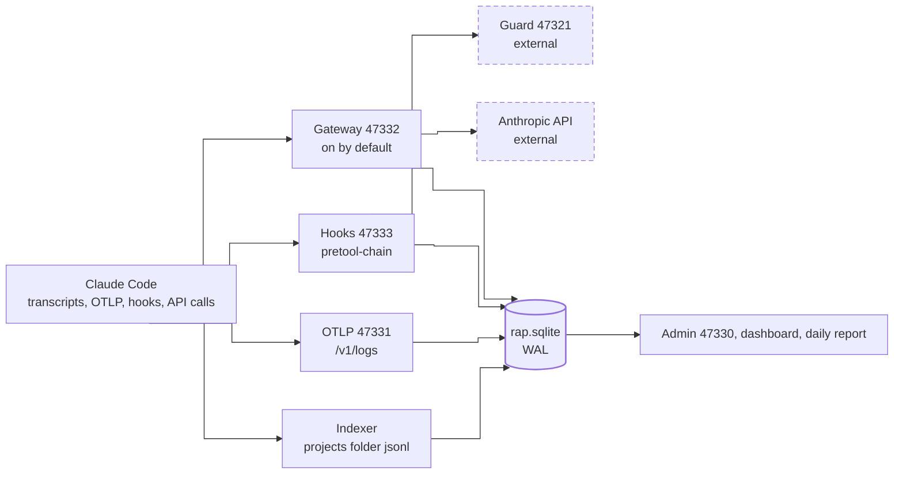

# Architecture

## Source Tree

```markdown
rust-agents-proxy/
├── src/
│   ├── main.rs : binary entry, clap commands (serve, tui, index, report, hook, status, doctor), no-command launch (detached serve, then dashboard), exit codes
│   ├── lib.rs : library root, public modules
│   ├── core/
│   │   ├── mod.rs : core module gateway
│   │   ├── config.rs : rap.toml loader, port, gateway, hook, indexer, and report settings, data directory and Claude home resolution
│   │   ├── context.rs : AppContext shared by every port and task, live counters, live-event broadcast channel
│   │   └── model.rs : row types, DataSource, HookOutcome, LiveEvent, status snapshot, deny round-trip constant
│   ├── serve/
│   │   └── mod.rs : serve entry, held port binds, detached background launch (serve.log), store and admin token setup, main and gateway runtimes, task supervision, shutdown
│   ├── store/
│   │   ├── mod.rs : SQLite schema, WAL, batch insert with dedupe, index cursors, daily report storage
│   │   └── query.rs : aggregates shared by the admin API, dashboard, and report, percentiles, cost estimate
│   ├── net/
│   │   ├── mod.rs : localhost HTTP ports gateway
│   │   ├── common.rs : 127.0.0.1 server loop, Host, Origin, and Sec-Fetch-Site rejection, response helpers
│   │   ├── admin/
│   │   │   ├── mod.rs : admin routes, token check, aggregates, reindex, report
│   │   │   ├── events.rs : Server-Sent Events stream of live events
│   │   │   ├── client.rs : blocking HTTP/1.1 admin client for the dashboard and status
│   │   │   ├── tests.rs : admin client, token, aggregate, and SSE tests
│   │   │   └── test_support.rs : temporary store, free ports, raw requests for network tests
│   │   ├── otlp/
│   │   │   ├── mod.rs : OTLP http/json receiver, gzip, size limits
│   │   │   ├── mapping.rs : log record to row mapping, attribute subset only
│   │   │   └── tests.rs : fixture mapping, key fallback, server checks
│   │   └── gateway/
│   │       ├── mod.rs : Anthropic API proxy, header copy, upstream call
│   │       ├── tap.rs : response tap, first byte and first token timing, SSE usage parser
│   │       └── tests.rs : chunk-boundary parsing, tap recording, upstream error, hop-by-hop headers
│   ├── hooks/
│   │   ├── mod.rs : hook server routes, request limits
│   │   ├── chain.rs : pretool-chain decision, guard answer synthesis, fail-closed
│   │   ├── rewrite.rs : conservative Bash rewrite (cat, ls, eza, git diff)
│   │   ├── relay.rs : instrumented relay of other hook routes
│   │   ├── upstream.rs : keep-alive HTTP client to the guard with a deadline
│   │   ├── record.rs : counters, live event, off-path store write
│   │   ├── client.rs : blocking HTTP client and the hook command
│   │   └── chain_tests.rs : chain tests against a fake guard server
│   ├── transcript/
│   │   ├── mod.rs : incremental indexer, one-shot run, periodic loop
│   │   ├── files.rs : recent jsonl discovery under the projects folder
│   │   ├── scan.rs : read complete lines after an offset, build rows
│   │   ├── lines.rs : minimal line deserialization, guard denial text reader
│   │   ├── tests.rs : indexer tests on synthetic transcripts
│   │   └── test_support.rs : temporary folders and test configuration
│   ├── report/
│   │   ├── mod.rs : daily report build, store, file write, schedule
│   │   ├── render.rs : aggregates to Korean Markdown with box tables, rule-based suggestions
│   │   ├── table.rs : light box-table renderer (Hangul width 2) and pipe-table to box-table conversion
│   │   └── tests.rs : index to aggregate to report flow, schedule time
│   ├── inventory/
│   │   ├── mod.rs : hook, MCP, agent, skill, and env-key inventory types, doctor entry
│   │   ├── load.rs : read settings.json, .claude.json, agent and skill headers, no values
│   │   ├── doctor.rs : data directory, ports, relay target, hook registration, allowed URL, telemetry, gateway, projects folder checks
│   │   └── tests.rs : inventory and doctor tests on fixture Claude homes
│   └── tui/
│       ├── mod.rs : terminal setup and restore, redraw-on-change event loop, command dispatch
│       ├── state.rs : tabs, card focus, layout and scroll, window, panel data, key handling, selection kept across snapshots
│       ├── cards.rs : card ids and kinds, per-card scroll and selection, click actions, mouse hit areas, scrollbar thumb math
│       ├── layout.rs : card boundary drag resize, ratios per group, card area split, drag areas
│       ├── mouse.rs : hover, click, boundary drag, wheel, scrollbar track click and thumb drag
│       ├── poller.rs : background collection (heavy panels every 10 s), settings, report, and admin-request threads
│       ├── format.rs : number, time, and token formats, display-width fitting
│       ├── sort.rs : sortable table column state
│       ├── theme.rs : dark palette
│       ├── win_ctrl.rs : always-on-top window and classic console font apply and restore (direct Win32 declarations)
│       ├── test_support.rs : synthetic configuration and snapshots
│       └── views/
│           ├── mod.rs : frame assembly, app bar (badge only), tab bar (seven tabs, no gaps then numbered compact labels when narrow), footer, help overlay
│           ├── common.rs : card frame, panel states, empty database state, scroll table and text card, card scrollbar, boundary handles
│           ├── overview.rs : status header, KPI cards, saved time, per-minute trend, live feed
│           ├── tables.rs : tools, hooks, and models tabs
│           ├── settings.rs : inventory and doctor results
│           └── report.rs : daily report viewer
├── tests/
│   └── fixtures/ : fixture Claude homes (inventory), transcripts, and OTLP payloads read by unit tests
├── assets/icon/
│   ├── build_icon.py : renders the two SVG sources into the multi-size ico with ImageMagick
│   ├── rust-agents-proxy.svg : large icon source
│   ├── rust-agents-proxy-small.svg : small icon source for 32 px and below
│   ├── rust-agents-proxy.ico : generated icon
│   └── rust-agents-proxy.rc : icon, version info, and manifest resources
├── .cargo/config.toml : project vendor source, gnullvm clang, ar, windres, and linker paths
├── .cmd/
│   ├── build.cmd : zero-downtime release build, Authenticode signing
│   ├── install-task.ps1 : Task Scheduler registration of serve
│   └── sign.ps1 : exe signing (organization or local self-signed certificate)
├── build.rs : windres resources, libunwind.dll copy for gnullvm
├── Cargo.toml : package metadata, dependencies, release profile (panic = "unwind")
├── rap.example.toml : full configuration example with defaults
├── vendor/ : gitignored vendored crates, regenerated with cargo vendor
├── README.md : usage guide
├── README-KO.md : usage guide in Korean
├── ARCHITECTURE-KO.md : this file in Korean
├── CLAUDE.md : project rules for agents
└── LICENSE.md : Apache-2.0
```

---

## Runtime Layout

1. **Processes**
    - `serve` is the one resident process; it owns the writable database and every port.
    - `tui`, `status`, `doctor`, `index`, `report`, and `hook` are short-lived processes of the same exe.
    - Launcher: with no command the exe probes the admin port; when it does not answer, it starts `serve` detached (no console, breaking away from the parent job when allowed, stderr to `serve.log`), waits up to 8 seconds for the port, and then runs the dashboard in the launcher process.
    - `tui` opens the database read-only and calls the admin API only for server status, reindex, and report generation.
    - `index` and `report` open their own writable connection; SQLite WAL mode with a 5-second busy timeout lets them run beside `serve`.
2. **Runtimes inside serve**
    - The main thread blocks on a multi-thread tokio runtime named `rap-main`.
    - It runs one task each for admin, OTLP, hooks (when `hooks.enabled`), the transcript indexer (when `indexer.enabled`), and the report scheduler (when `report.enabled`).
    - The gateway runs on a dedicated OS thread, `rap-gateway`, with its own multi-thread runtime of 2 workers; the gateway is on by default and is skipped only when `gateway.enabled = false`.
    - The split keeps long streaming relays apart from hook and indexing load.
3. **Failure isolation**
    - The release profile sets `panic = "unwind"` so a panic stays inside one task.
    - Every accepted connection is its own tokio task, so a handler panic ends that connection only.
    - Start order: the gateway upstream is validated, the ports are bound in the order admin, OTLP, hooks, gateway and kept until the servers take them over, and only then the store is opened and `admin.token` is written, so a second `serve` that loses the admin bind never overwrites the token.
    - Required: admin, and hooks when `hooks.enabled`; a bind failure or an end or panic of either stops `serve` with a non-zero exit code.
    - Optional: OTLP and gateway; a bind failure skips that server with a warning, and an end of OTLP, the indexer, the report scheduler, or the gateway thread is logged and sent as a warn `Notice` live event while `serve` keeps running.
    - With `hooks.enabled = false` the hooks port is not taken.
    - `Ctrl+C` leaves the wait loop and aborts every task.
    - The dashboard turns panics in its background threads into panel states instead of crashing.
4. **Blocking work**
    - SQLite access, indexing, report generation, and port probes run through `spawn_blocking`.
    - A hook event is written to the store off the response path, and the gateway tap writes its row when the response body is dropped.
5. **Shared state**
    - `AppContext` holds the configuration, the store, the live-event broadcast sender (capacity 1024), atomic live counters, the start time, and the admin token.
6. **Indexer cadence**
    - The indexer polls every `indexer.interval_secs` (30 s) on a blocking thread; its first run emits no live events.
    - The report scheduler waits for the first indexer run (polling every 2 s, up to 10 minutes, a warn notice on timeout) and then regenerates yesterday's report, replacing a stored one.

---

## Data Flow

### 1. Sources To Views

1. **Diagram**
    - Claude Code feeds four intake paths into one database that three views read.



2. **Transcript path**
    - The indexer reads `<claude_home>\projects\**\*.jsonl` files modified within `indexer.backfill_days`.
    - A cursor per file (size, modified time, read offset) makes each run incremental; only complete lines are consumed, and a file that shrank is re-read from the start.
    - Rows are committed in chunks of 2000.
3. **OTLP path**
    - Claude Code posts logs to `/v1/logs`; three event kinds become rows and the rest are ignored.
4. **Hook path**
    - Claude Code posts the PreToolUse payload to `/hook/pretool-chain`; the next diagram shows the decision.
5. **Gateway path**
    - A tap around the response body records timing and token usage when the body ends or is dropped, including on abort.
    - Only `POST /v1/messages` is tapped; the first `content_block_delta` event marks the first token.
    - An upstream connection error returns `502`; response headers that miss `gateway.upstream_timeout_secs` return `504`, and the streamed body has no deadline.
    - The author's setup routes Claude Code through it with `ANTHROPIC_BASE_URL=http://127.0.0.1:47332` and `ANTHROPIC_DEFAULT_HAIKU_MODEL`, so Claude Code's own API traffic passes this path.
6. **Views**
    - The admin API, the dashboard, and the daily report all read the same aggregate queries in `store/query.rs`.
    - The dashboard has seven tabs on keys `1`-`7` (overview, tools, hooks, models, agents, settings, report) and no gateway tab; gateway timing stays available through `GET /api/gateway` and the report, and the overview server-status card shows the gateway port as a status dot.
    - Live events travel through a broadcast channel that the admin SSE stream reads; the live counters are separate atomics.

### 2. pretool-chain

1. **Diagram**
    - The chain rewrites, asks the guard, and synthesizes the answer.


2. **Rules**
    - The guard always sees the final command, never the original when a rewrite applied.
    - rap never synthesizes a decision the guard did not give: an explicit allow keeps allow, no decision returns `updatedInput` without `permissionDecision`, and ask returns ask with `updatedInput`.
    - A guard answer that carries its own `updatedInput` wins over the rewrite.
    - A decision other than allow, ask, or deny (for example `defer`) on a rewritten command drops the rewrite and sends the original command to the guard again with the same deadline; that second answer is returned as it is, and a failed second call is fail-closed.
    - A command containing `>|` is never rewritten.
    - The deadline is `hooks.guard_deadline_ms` (3000 ms), well under the 10-second hook timeout in `settings.json`.

---

## Data Store

1. **Engine**
    - SQLite through `rusqlite` with the bundled library, one connection behind a mutex, `journal_mode = WAL`, `synchronous = NORMAL`, `busy_timeout = 5000`.
    - Readers such as the dashboard open their own read-only connection.
    - Timestamps are RFC 3339 UTC strings, and every aggregate window is half-open: `ts >= since AND ts < until`.
2. **Tables**
    - `api_requests`: one model request; unique `request_key`; source, model, agent, session, four token counters, `duration_ms`, `first_byte_ms`, `first_token_ms`, `status`.
    - `tool_calls`: one tool call; unique `tool_use_id`; tool name, duration, error flag and kind.
    - `hook_events`: one hook verdict; unique `event_key`; route, guard label, outcome, detail, duration, `saved_ms`.
    - `sessions`: one session; first and last timestamp and the project folder name.
    - `index_cursors`: one transcript file; size, modified time, read offset, and resume state.
    - `daily_reports`: one report per date; generation time and the Markdown.
3. **Batch write**
    - `insert_batch` writes one batch in a single transaction in this order: API requests, tool call starts, tool completions, hook events, sessions.
4. **Content**
    - No table has a column for prompt text, command text, file contents, or headers; `detail` holds only a short command name.

---

## Source Merge Rules

1. **Keys**
    - `api_requests.request_key`: transcript uses the message id, OTLP uses `otlp:<request_id>` (or `client_request_id`, or session, time, and sequence), and the gateway uses `gw:<millis>:<counter>`.
    - `tool_calls.tool_use_id`: shared by the transcript and OTLP.
    - `hook_events.event_key`: `hook-<millis>-<pid>-<seq>` from the hook server, `transcript:<tool_use_id>:deny` from the transcript, and `otlp:<session>:<sequence or time>:<hook name>` from OTLP.
2. **Same key, same source**
    - An API request that arrives again with larger token counts or a longer duration updates the stored row, so a message split across reads ends with its final usage.
    - A tool call or hook event with an existing key is ignored, so the first writer wins.
    - A tool completion fills `duration_ms` only while it is empty, from the gap between the start and the completion timestamps.
3. **Request totals**
    - Request counts, token totals, model wait, model and agent usage, cache breaks, and per-minute trends read only `source = 'transcript'` rows, so an OTLP or gateway row for the same request never counts twice.
    - Gateway timing reads only `source = 'gateway'` rows, and the report prints the row count per source.
4. **Hook denials**
    - A denial is seen twice: once as the denied tool result in the transcript and once at the hook server.
    - The count is per event: a hook-server denial is left out when the same session has a transcript denial from 2 seconds before to 10 seconds after it, and a hook-server denial with an empty session id always counts.
    - OTLP denial rows are stored but not counted in the aggregates.
5. **Estimates**
    - Lost time is the denial count times 4200 ms, the 7-day median model round trip after a denial, and saved time is the sum of `saved_ms` of rewrites.
    - Cost uses a built-in per-model table of API rates; an unknown model counts as zero.
6. **Cache breaks**
    - A request with at least 20,000 cache-creation tokens and a cache read below half of the previous context is a candidate.
    - The likely cause is read from the gap to the previous request: over 1 hour idle, over 5 minutes idle (TTL), a model change, or an unknown prefix change.

---

## Security Boundaries

1. **Network exposure**
    - Every listener binds `127.0.0.1` only, in IPv4.
2. **Browser and rebinding defense**
    - `net/common.rs` checks every request on every port: the `Host` header must be `127.0.0.1:<port>` or `localhost:<port>`, and any `Origin` or `Sec-Fetch-Site` header is rejected with `403`.
3. **Admin token**
    - Every `POST` on the admin port needs the `x-rap-token` header.
    - The token is 32 bytes from the OS random source, hex-encoded, written to `admin.token` at each start; the code sets no file permission, so the file inherits the data directory's access rules.
    - The comparison is an HMAC-SHA-256 tag check through `ring`, which is constant time and leaks no length.
4. **Fail-closed chain**
    - A guard that is unreachable, late, non-2xx, or not a JSON object yields a deny; the chain never allows on its own.
    - The registration `onFailure: "block"` makes Claude Code deny when the chain itself is down.
5. **Input limits**
    - Hook and OTLP bodies are limited to 16 MiB (OTLP also after gzip inflate), gateway requests to 64 MiB, and a guard answer to 8 MiB.
    - The admin client rejects CR and LF in request values, and the hook client accepts only the routes `a-z`, `0-9`, `-`, and `relay/<name>`.
6. **Gateway**
    - The upstream must be an `https` address, verified against the bundled web PKI roots through rustls.
    - Credentials in request headers are forwarded to the upstream and never stored; response bodies are inspected only for model and usage.
7. **Configuration access**
    - The inventory reads `settings.json` and `.claude.json` for hook entries, MCP names, and env key names; env values serve comparisons only and are never printed or stored.
8. **Child processes**
    - Only `serve::ensure_background_serve` spawns a child: the same exe as `serve`, detached, once per no-command launch when the admin port does not answer; `build.rs` spawns build tools at build time.
    - The hook chain, intake, indexing, and dashboard paths spawn nothing.
