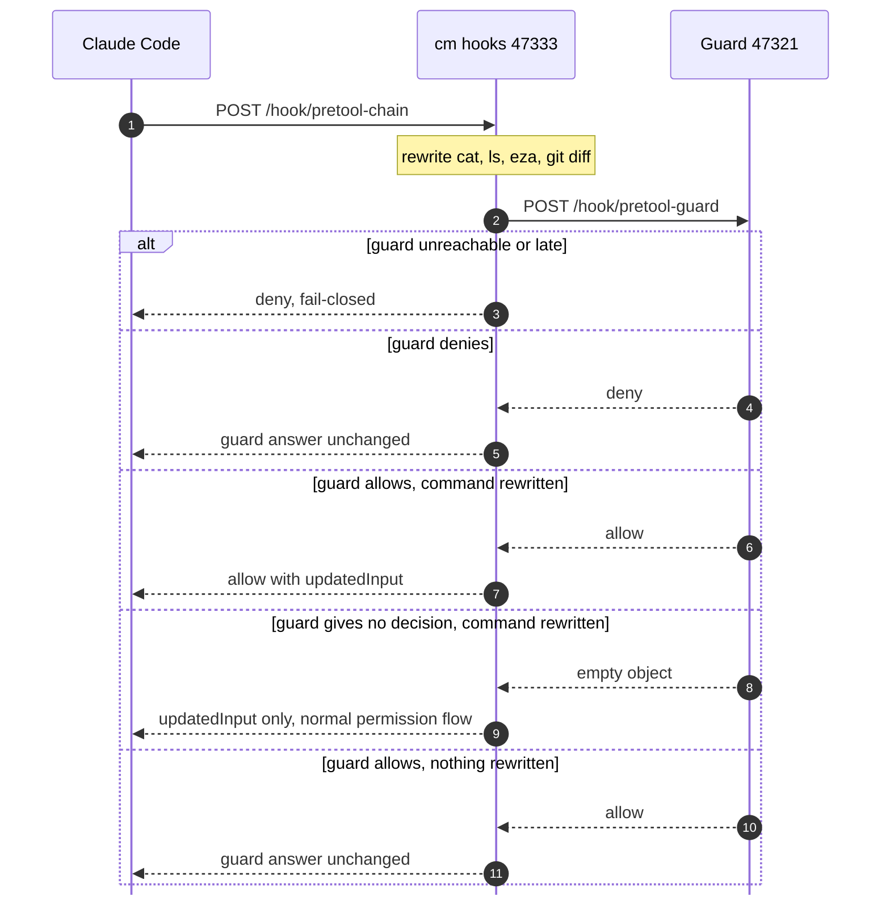

# Architecture

## Source Tree

```markdown
claude-monitor/
├── src/
│   ├── main.rs : binary entry, clap commands (serve, start, tui, index, report, hook, status, doctor), no-command launch (detached serve, then dashboard), exit codes
│   ├── lib.rs : library root, public modules
│   ├── core/
│   │   ├── mod.rs : core module gateway
│   │   ├── config.rs : config.toml loader (~/.config/claude-monitor/config.toml), port, gateway, hook, indexer, and report settings, data directory (default ~/.config/claude-monitor, the folder of config.toml; CM_DATA_DIR overrides) and Claude home resolution
│   │   ├── context.rs : AppContext shared by every port and task, live counters, live-event broadcast channel
│   │   └── model.rs : row types, DataSource, HookOutcome, LiveEvent, status snapshot, deny round-trip constant
│   ├── serve/
│   │   └── mod.rs : serve entry, held port binds, detached background launch (serve.log), store and admin token setup, main and gateway runtimes, task supervision, shutdown
│   ├── store/
│   │   ├── mod.rs : SQLite schema, WAL, batch insert with dedupe, index cursors, daily report storage
│   │   └── query.rs : aggregates shared by the admin API, dashboard, and report, percentiles, cost estimate
│   ├── net/
│   │   ├── mod.rs : localhost HTTP ports gateway
│   │   ├── common.rs : 127.0.0.1 server loop, Host, Origin, and Sec-Fetch-Site rejection, response helpers
│   │   ├── admin/
│   │   │   ├── mod.rs : admin routes, token check, aggregates, reindex, report
│   │   │   ├── events.rs : Server-Sent Events stream of live events
│   │   │   ├── client.rs : blocking HTTP/1.1 admin client for the dashboard and status
│   │   │   ├── tests.rs : admin client, token, aggregate, and SSE tests
│   │   │   └── test_support.rs : temporary store, free ports, raw requests for network tests
│   │   ├── otlp/
│   │   │   ├── mod.rs : OTLP http/json receiver, gzip, size limits
│   │   │   ├── mapping.rs : log record to row mapping, attribute subset only
│   │   │   └── tests.rs : fixture mapping, key fallback, server checks
│   │   └── gateway/
│   │       ├── mod.rs : Anthropic API proxy, header copy, upstream call
│   │       ├── tap.rs : response tap, first byte and first token timing, SSE usage parser
│   │       └── tests.rs : chunk-boundary parsing, tap recording, upstream error, hop-by-hop headers
│   ├── hooks/
│   │   ├── mod.rs : hook server routes, request limits
│   │   ├── chain.rs : pretool-chain decision, guard answer synthesis, fail-closed
│   │   ├── rewrite.rs : conservative Bash rewrite (cat, ls, eza, git diff)
│   │   ├── relay.rs : instrumented relay of other hook routes
│   │   ├── standby.rs : standby hint route, additionalContext answer for tool failures and prompts
│   │   ├── upstream.rs : keep-alive HTTP client to the guard with a deadline
│   │   ├── record.rs : counters, live event, off-path store write
│   │   ├── client.rs : blocking HTTP client and the hook command
│   │   └── chain_tests.rs : chain tests against a fake guard server
│   ├── transcript/
│   │   ├── mod.rs : incremental indexer, one-shot run, periodic loop
│   │   ├── files.rs : recent jsonl discovery under the projects folder
│   │   ├── scan.rs : read complete lines after an offset, build rows
│   │   ├── lines.rs : minimal line deserialization, guard denial text reader
│   │   ├── tests.rs : indexer tests on synthetic transcripts
│   │   └── test_support.rs : temporary folders and test configuration
│   ├── report/
│   │   ├── mod.rs : daily report build, store, file write, schedule
│   │   ├── render.rs : aggregates to Korean Markdown with box tables, rule-based suggestions
│   │   ├── table.rs : light box-table renderer (Hangul width 2) and pipe-table to box-table conversion
│   │   └── tests.rs : index to aggregate to report flow, schedule time
│   ├── inventory/
│   │   ├── mod.rs : hook, MCP, agent, skill, and env-key inventory types, doctor entry
│   │   ├── load.rs : read settings.json, .claude.json, agent and skill headers, no values
│   │   ├── doctor.rs : data directory, ports, relay target, hook registration, allowed URL, telemetry, gateway, projects folder checks
│   │   └── tests.rs : inventory and doctor tests on fixture Claude homes
│   ├── power/
│   │   ├── mod.rs : standby monitor thread, sleep postponement (direct Win32 declaration), gap ledger, hint text
│   │   └── tests.rs : gap detection, hold and release, hint selection, hook answer tests
│   └── tui/
│       ├── mod.rs : terminal setup and restore, redraw-on-change event loop (calls AppState::tick and shortens the wait to the press deadline), state load at start, SaveState queues a write on the state writer thread owned by the terminal guard, command dispatch, resize cancels a card move
│       ├── state.rs : tabs, card focus, layout and scroll, window, display language, press and move state, panel data, key handling (Shift+arrow, l, L), selection kept across snapshots
│       ├── cards.rs : card ids and kinds, per-card scroll and selection, click actions, mouse hit areas, scrollbar thumb math
│       ├── layout.rs : card boundary drag resize, ratios and card order per group, card area split, drag areas
│       ├── card_move.rs : card move state machine (impl AppState): 400 ms title press, preview, commit, cancel, Shift+arrow one-slot move; time comes in as an Instant argument (AppState::tick), so tests inject the clock
│       ├── layout_store.rs : state file tui.toml in the home config folder: load at start, state text and save request build, atomic write (temporary file, then rename; the whole symbolic link chain, 16 links at most, is resolved first so every link survives), start-up removal of stale temporary files only (older than 10 minutes, never the running process's), skip invalid entries with one notice, copy an unreadable file to `.bak`
│       ├── state_writer.rs : state writer thread: channel of save requests coalesced to the latest per path, flush and join on drop (waits at most 5 seconds, then reports it so the terminal guard warns on stderr), failures sent back as UiMessage::StateSaveFailed
│       ├── i18n.rs : message catalog with English and Korean text per entry (default English), format functions for texts with values, help rows
│       ├── mouse.rs : hover, click, title press, boundary drag, card move preview and commit, wheel, scrollbar track click and thumb drag; a move without a button, a new press, a tab switch, or a resize ends every drag like a release, and a moved drag saves
│       ├── poller.rs : background collection (heavy panels every 10 s), settings, report, and admin-request threads
│       ├── format.rs : number, time, and token formats, display-width fitting, card title segment fitting
│       ├── sort.rs : sortable table column state
│       ├── theme.rs : dark palette (the pinned state has its own fill, apart from warn; every event kind, including API, has its own indexed color apart from the accent)
│       ├── win_ctrl.rs : always-on-top window and classic console font apply and restore (direct Win32 declarations)
│       ├── test_support.rs : synthetic configuration and snapshots
│       └── views/
│           ├── mod.rs : frame assembly, app bar (badge only), tab bar (seven tabs, no gaps then numbered compact labels when narrow), footer, help overlay
│           ├── common.rs : card frame, panel states, empty database state, scroll table card (column fit rules, aux line region, header drop on one-row cards) and text card, card scrollbar (one-cell thumb on a one-row body), boundary handles
│           ├── overview.rs : status header, KPI cards, saved time, per-minute trend
│           ├── feed.rs : live event feed table columns and row cells, detail and same-kind context lines
│           ├── tables.rs : tools and hooks tabs
│           ├── models.rs : models and agents tabs, stats tables, detail card, cache-break candidates
│           ├── settings.rs : hook, MCP, agent, and doctor table cards with their auxiliary lines
│           ├── report.rs : daily report viewer
│           └── render_matrix.rs : buffer render checks (test only): every tab in both languages at 60x16, 100x30, and 130x40, exact cells, hit areas, source rule scans
├── tests/
│   └── fixtures/ : fixture Claude homes (inventory), transcripts, and OTLP payloads read by unit tests
├── assets/icon/
│   ├── claude-monitor.webp, claude-monitor-small.webp : lossless WebP masters (a 1024 px tile for 40 px and larger, a 256 px hexagon crop for 32 px and smaller)
│   ├── build_icon.py : renders the two WebP masters into the multi-size ico with ImageMagick
│   └── claude-monitor.ico : generated icon, embedded by build.rs
├── docs/
│   └── config.example.toml : full configuration example with defaults
├── build.rs : writes the resource script (icon, English VERSIONINFO, asInvoker manifest) into OUT_DIR, compiles it with the windres for the target architecture and drops an object with the wrong COFF machine type (optional: only a warning when no tool works), libunwind.dll copy for gnullvm
├── Cargo.toml : package metadata, dependencies, release profile (panic = "unwind")
├── README.md : install and usage guide
├── README-ko.md : usage guide in Korean
├── ARCHITECTURE-ko.md : this file in Korean
└── LICENSE.md : Apache-2.0
```

---

## Runtime Layout

1. **Processes**
    - `serve` is the one resident process; it owns the writable database and every port.
    - `tui`, `start`, `status`, `doctor`, `index`, `report`, and `hook` are short-lived processes of the same exe; `start` runs only the launcher step below and exits without the dashboard.
    - Launcher: with no command the exe probes the admin port; when it does not answer, it starts `serve` detached (no console, breaking away from the parent job when allowed, stderr to `serve.log`), waits up to 8 seconds for the port, and then runs the dashboard in the launcher process.
    - `tui` opens the database read-only and calls the admin API only for server status, reindex, and report generation.
    - The one file `tui` writes is its own state file `tui.toml` in `~/.config/claude-monitor/`, next to `config.toml` even when `data_dir` moves (display language, card orders, split ratios, column widths); see Dashboard State.
    - `index` and `report` open their own writable connection; SQLite WAL mode with a 5-second busy timeout lets them run beside `serve`.
2. **Runtimes inside serve**
    - The main thread blocks on a multi-thread tokio runtime named `cm-main`.
    - It runs one task each for admin, OTLP, hooks (when `hooks.enabled`), the transcript indexer (when `indexer.enabled`), and the report scheduler (when `report.enabled`).
    - The gateway runs on a dedicated OS thread, `cm-gateway`, with its own multi-thread runtime of 2 workers; the gateway is on by default and is skipped only when `gateway.enabled = false`.
    - The split keeps long streaming relays apart from hook and indexing load.
    - With `power.enabled` (the default), a plain OS thread `cm-power` ticks every 5 seconds; `SetThreadExecutionState` binds the sleep postponement to the calling thread, so this one thread both sets and clears it.
3. **Failure isolation**
    - The release profile sets `panic = "unwind"` so a panic stays inside one task.
    - Every accepted connection is its own tokio task, so a handler panic ends that connection only.
    - Start order: the gateway upstream is validated, the ports are bound in the order admin, OTLP, hooks, gateway and kept until the servers take them over, and only then the store is opened and `admin.token` is written, so a second `serve` that loses the admin bind never overwrites the token.
    - Required: admin, and hooks when `hooks.enabled`; a bind failure or an end or panic of either stops `serve` with a non-zero exit code.
    - A failure to create the `cm-power` thread is printed and `serve` continues without the standby monitor.
    - Optional: OTLP and gateway; a bind failure skips that server with a warning, and an end of OTLP, the indexer, the report scheduler, or the gateway thread is logged and sent as a warn `Notice` live event while `serve` keeps running.
    - With `hooks.enabled = false` the hooks port is not taken.
    - `Ctrl+C` leaves the wait loop and aborts every task.
    - The dashboard turns panics in its background threads into panel states instead of crashing.
4. **Blocking work**
    - SQLite access, indexing, report generation, and port probes run through `spawn_blocking`.
    - A hook event is written to the store off the response path, and the gateway tap writes its row when the response body is dropped.
5. **Shared state**
    - `AppContext` holds the configuration, the store, the live-event broadcast sender (capacity 1024), atomic live counters, the start time, the admin token, and the `PowerState` (hold flag, last tick time, and the in-memory gap ledger of up to 32 gaps and 512 notified session and gap pairs).
6. **Indexer cadence**
    - The indexer polls every `indexer.interval_secs` (30 s) on a blocking thread; its first run emits no live events.
    - The report scheduler waits for the first indexer run (polling every 2 s, up to 10 minutes, a warn notice on timeout) and then regenerates yesterday's report, replacing a stored one.

---

## Data Flow

### 1. Sources To Views

1. **Diagram**
    - Claude Code feeds four intake paths into one database that three views read.


2. **Transcript path**
    - The indexer reads `<claude_home>\projects\**\*.jsonl` files modified within `indexer.backfill_days`.
    - A cursor per file (size, modified time, read offset) makes each run incremental; only complete lines are consumed, and a file that shrank is re-read from the start.
    - Rows are committed in chunks of 2000.
3. **OTLP path**
    - Claude Code posts logs to `/v1/logs`; three event kinds become rows and the rest are ignored.
4. **Hook path**
    - Claude Code posts the PreToolUse payload to `/hook/pretool-chain`; the next diagram shows the decision.
    - Claude Code posts PostToolUseFailure and UserPromptSubmit payloads to `/hook/standby-hint` when the user registers it; the route reads the in-memory gap ledger and writes one hook event row.
5. **Standby path**
    - Each tick compares the wall clock with the previous tick; a jump over `power.gap_threshold_secs` is a gap, because the whole process was paused by Modern Standby or sleep.
    - The activity mark is the sum of the gateway request and hook call counters; a changed mark or an open gateway stream keeps the postponement for `power.awake_grace_secs`.
    - Each gap stores `active`, whether the previous tick was within `power.awake_grace_secs` of activity; a step backward of the wall clock counts as no activity.
    - A failure hint covers gaps overlapping the tool run (`duration_ms` plus one tick) whatever `active` says; a prompt hint, and the conditional hint for a failure without `duration_ms`, cover `active` gaps ended within `power.hint_window_secs`, once per session and gap start time.
    - When the monitor has not ticked for longer than the threshold, the hint route treats the time since the last tick as a pending gap with the last tick's `active`; it shares the start time of the gap recorded later, so one standby never produces two prompt hints.
    - The monitor records a gap before it stores the new tick time, so a hook arriving in between still sees either the pending or the recorded gap.
    - A drop guard on the `cm-power` thread sets the last tick time to 0 and sends a warn notice when the thread ends, so a dead monitor never turns into a permanent pending gap.
6. **Gateway path**
    - A tap around the response body records timing and token usage when the body ends or is dropped, including on abort.
    - Only `POST /v1/messages` is tapped; the first `content_block_delta` event marks the first token.
    - An upstream connection error returns `502`; response headers that miss `gateway.upstream_timeout_secs` return `504`, and the streamed body has no deadline.
    - Claude Code's own API traffic passes this path when its `env` sets `ANTHROPIC_BASE_URL=http://127.0.0.1:47332` (plus `ANTHROPIC_DEFAULT_HAIKU_MODEL`).
7. **Views**
    - The admin API, the dashboard, and the daily report all read the same aggregate queries in `store/query.rs`.
    - The dashboard has seven tabs on keys `1`-`7` (overview, tools, hooks, models, agents, settings, report) and no gateway tab; gateway timing stays available through `GET /api/gateway` and the report, and the overview server-status card shows the gateway port as a status dot.
    - Live events travel through a broadcast channel that the admin SSE stream reads; the live counters are separate atomics.

### 2. pretool-chain

1. **Diagram**
    - The chain rewrites, asks the guard, and synthesizes the answer.



2. **Rules**
    - The guard always sees the final command, never the original when a rewrite applied.
    - cm never synthesizes a decision the guard did not give: an explicit allow keeps allow, no decision returns `updatedInput` without `permissionDecision`, and ask returns ask with `updatedInput`.
    - A guard answer that carries its own `updatedInput` wins over the rewrite.
    - A decision other than allow, ask, or deny (for example `defer`) on a rewritten command drops the rewrite and sends the original command to the guard again with the same deadline; that second answer is returned as it is, and a failed second call is fail-closed.
    - A command containing `>|` is never rewritten.
    - The deadline is `hooks.guard_deadline_ms` (3000 ms), well under the 10-second hook timeout in `settings.json`.

---

## Dashboard State

1. **Modules**
    - `tui/i18n.rs` holds every screen text as one catalog entry with its English and Korean text; English is the default, and values such as paths, model and tool names, and log text pass through untranslated.
    - `tui/card_move.rs` holds the press and move state machine; `AppState::tick(now)` enters move mode once a title press is older than 400 ms, independent of mouse motion, and the event loop passes the real clock while tests pass their own `Instant`.
    - `tui/layout_store.rs` loads and saves the state file; `AppState::load_tui_state` runs once at start and `AppState::build_state_save` builds the file text when the loop dispatches `UiCommand::SaveState`, and `tui/state_writer.rs` writes it.
    - `tui/state_writer.rs` runs one writer thread fed by a channel: queued requests for the same path collapse into the latest one, a failed write returns as `UiMessage::StateSaveFailed` and becomes an error toast, and `TerminalGuard` drops the writer after restoring the terminal, which writes the last queued request and joins the thread on every exit path, waiting at most 5 seconds before it warns on stderr instead of hanging.
2. **Card move**
    - Only card groups whose slot holds exactly one card are reorderable; the overview stacked-row groups are not.
    - Press, preview, and commit run on mouse events, and the slot sizes stay with the slots while the cards move between them.
    - `Esc`, a tab switch, or a resize cancels the move and restores the order from before the press.
    - A commit that changes the order and `Shift+arrow` return `UiCommand::SaveState`.
3. **State file**
    - `~/.config/claude-monitor/tui.toml` (next to `config.toml`; it stays there when `data_dir` moves and falls back to `<data_dir>` only when no home folder resolves; name from `TUI_STATE_FILE_NAME` in `core/config.rs`) holds `version = 1`, `language`, `[orders]`, `[ratios]`, and `[column_widths]` keyed by stable group and table names (`event_feed`, `tool_table`, `hook_table`, `model_table`, `cache_breaks`, `agent_table`, `settings_hooks`, `settings_mcp`, `settings_agents`, `settings_doctor`); only entries that differ from the default layout are written, and a width list with a wrong length or a width above 512 is skipped.
    - The write goes to a temporary file in the same folder and then renames over the target, so an interrupted write leaves the old file intact, and it never runs on the input thread.
    - When `tui.toml` is a symbolic link, the save follows the whole link chain (16 links at most; a deeper chain fails the save), creates the temporary file in the real file's folder, syncs it, and renames it over the real file, never over a link; the start-up cleanup of leftover temporary files looks in both folders and removes only stale ones (not modified for 10 minutes and not tagged with the running process id), so another instance's live temporary file survives.
    - An unreadable or other-version file is copied to `tui.toml.bak` at start, before the first save overwrites it.
    - A missing file means the defaults; an unreadable file, an unsupported version, or an invalid entry is skipped with one notice.
    - Every per-user file lives under `~/.config/claude-monitor/` (see README Data Directory).

---

## Data Store

1. **Engine**
    - SQLite through `rusqlite` with the bundled library, one connection behind a mutex, `journal_mode = WAL`, `synchronous = NORMAL`, `busy_timeout = 5000`.
    - Readers such as the dashboard open their own read-only connection.
    - Timestamps are RFC 3339 UTC strings, and every aggregate window is half-open: `ts >= since AND ts < until`.
2. **Tables**
    - `api_requests`: one model request; unique `request_key`; source, model, agent, session, four token counters, `duration_ms`, `first_byte_ms`, `first_token_ms`, `status`.
    - `tool_calls`: one tool call; unique `tool_use_id`; tool name, duration, error flag and kind.
    - `hook_events`: one hook verdict; unique `event_key`; route, guard label, outcome, detail, duration, `saved_ms`.
    - `sessions`: one session; first and last timestamp and the project folder name.
    - `index_cursors`: one transcript file; size, modified time, read offset, and resume state.
    - `daily_reports`: one report per date; generation time and the Markdown.
3. **Batch write**
    - `insert_batch` writes one batch in a single transaction in this order: API requests, tool call starts, tool completions, hook events, sessions.
4. **Content**
    - No table has a column for prompt text, command text, file contents, or headers; `detail` holds only a short command name.

---

## Source Merge Rules

1. **Keys**
    - `api_requests.request_key`: transcript uses the message id, OTLP uses `otlp:<request_id>` (or `client_request_id`, or session, time, and sequence), and the gateway uses `gw:<millis>:<counter>`.
    - `tool_calls.tool_use_id`: shared by the transcript and OTLP.
    - `hook_events.event_key`: `hook-<millis>-<pid>-<seq>` from the hook server, `transcript:<tool_use_id>:deny` from the transcript, and `otlp:<session>:<sequence or time>:<hook name>` from OTLP.
2. **Same key, same source**
    - An API request that arrives again with larger token counts or a longer duration updates the stored row, so a message split across reads ends with its final usage.
    - A tool call or hook event with an existing key is ignored, so the first writer wins.
    - A tool completion fills `duration_ms` only while it is empty, from the gap between the start and the completion timestamps.
3. **Request totals**
    - Request counts, token totals, model wait, model and agent usage, cache breaks, and per-minute trends read only `source = 'transcript'` rows, so an OTLP or gateway row for the same request never counts twice.
    - Gateway timing reads only `source = 'gateway'` rows, and the report prints the row count per source.
4. **Hook denials**
    - A denial is seen twice: once as the denied tool result in the transcript and once at the hook server.
    - The count is per event: a hook-server denial is left out when the same session has a transcript denial from 2 seconds before to 10 seconds after it, and a hook-server denial with an empty session id always counts.
    - OTLP denial rows are stored but not counted in the aggregates.
5. **Estimates**
    - Lost time is the denial count times 4200 ms, the 7-day median model round trip after a denial, and saved time is the sum of `saved_ms` of rewrites.
    - Cost uses a built-in per-model table of API rates; an unknown model counts as zero.
6. **Cache breaks**
    - A request with at least 20,000 cache-creation tokens and a cache read below half of the previous context is a candidate.
    - The likely cause is read from the gap to the previous request: over 1 hour idle, over 5 minutes idle (TTL), a model change, or an unknown prefix change.

---

## Security Boundaries

1. **Network exposure**
    - Every listener binds `127.0.0.1` only, in IPv4.
2. **Browser and rebinding defense**
    - `net/common.rs` checks every request on every port: the `Host` header must be `127.0.0.1:<port>` or `localhost:<port>`, and any `Origin` or `Sec-Fetch-Site` header is rejected with `403`.
3. **Admin token**
    - Every `POST` on the admin port needs the `x-cm-token` header.
    - The token is 32 bytes from the OS random source, hex-encoded, written to `admin.token` at each start; the code sets no file permission, so the file inherits the data directory's access rules.
    - The comparison is an HMAC-SHA-256 tag check through `ring`, which is constant time and leaks no length.
4. **Fail-closed chain**
    - A guard that is unreachable, late, non-2xx, or not a JSON object yields a deny; the chain never allows on its own.
    - The registration `onFailure: "block"` makes Claude Code deny when the chain itself is down.
5. **Input limits**
    - Hook and OTLP bodies are limited to 16 MiB (OTLP also after gzip inflate), gateway requests to 64 MiB, and a guard answer to 8 MiB.
    - The admin client rejects CR and LF in request values, and the hook client accepts only the routes `a-z`, `0-9`, `-`, and `relay/<name>`.
6. **Gateway**
    - The upstream must be an `https` address, verified against the bundled web PKI roots through rustls.
    - Credentials in request headers are forwarded to the upstream and never stored; response bodies are inspected only for model and usage.
7. **Configuration access**
    - The inventory reads `settings.json` and `.claude.json` for hook entries, MCP names, and env key names; env values serve comparisons only and are never printed or stored.
8. **Child processes**
    - Only `serve::ensure_background_serve` spawns a child: the same exe as `serve`, detached, once per no-command or `start` launch when the admin port does not answer; `build.rs` spawns build tools at build time.
    - The hook chain, intake, indexing, and dashboard paths spawn nothing.
9. **OS power request**
    - The standby monitor's only OS import is `kernel32!SetThreadExecutionState`, called with `ES_CONTINUOUS | ES_SYSTEM_REQUIRED` or `ES_CONTINUOUS`; `ES_DISPLAY_REQUIRED` is never set, so the screen-off and lock policy keeps working.
    - The dashboard declares its own window and console-font calls in `tui/win_ctrl.rs` (`user32`, `kernel32`); they touch only the terminal window that runs the dashboard.
    - The standby hint route reads `hook_event_name`, `session_id`, and `duration_ms` only; the error text, tool input, and prompt text are never read into a stored value or a log.
